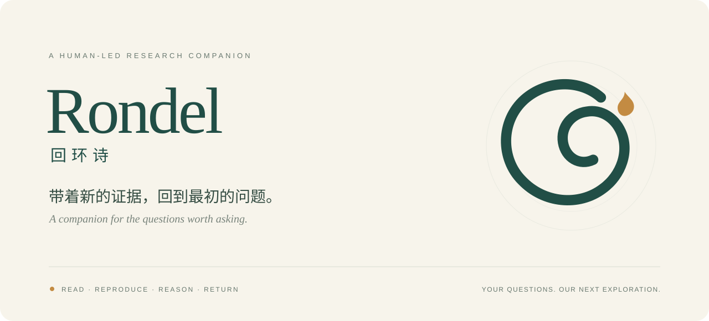

<p align="center">
  <picture>
    <source media="(prefers-color-scheme: dark)" srcset="docs/assets/rondel-hero-dark.svg">
    
  </picture>
</p>

<p align="center">
  <a href="README.md">中文</a> · <b>English</b><br>
  <a href="https://github.com/ZoltraakDiego/Rondel/releases/latest">Download the skill</a> &nbsp; / &nbsp;
  <a href="docs/architecture.md">Architecture</a> &nbsp; / &nbsp;
  <a href="examples/guided-init/README.md">A first conversation</a>
</p>

## A companion for the questions worth asking

Rondel is a human-led research skill that helps turn uncertain observations into questions, evidence and work that can be continued. The researcher chooses the questions, interprets findings and makes the important decisions. The agent helps find literature, inspect mature implementations, write code, check protocols, organize evidence and preserve the path taken.

The name evokes a returning poetic form: revisit the first question with new evidence and deepen your understanding with each cycle. The research path starts with broad reading, a small core of papers for deep study and faithful reproduction, then limited changes and attribution. Useful negative findings, open questions and parked directions remain part of the record.

## Get started

Download `rondel-main-0.1.1.zip` from [Releases](https://github.com/ZoltraakDiego/Rondel/releases/latest), extract it and keep the complete `rondel-main` directory. Install it into the project skill location below and confirm that your client discovers it. Local helpers require a working Python 3.11+ interpreter; the package includes PyYAML.

| Client | Project skill location | Invocation and guide |
| :--- | :--- | :--- |
| Codex | `.agents/skills/rondel-main/` | `$rondel-main` · [Guide](adapters/codex.md) |
| Claude Code | `.claude/skills/rondel-main/` | `/rondel-main` · [Guide](adapters/claude-code.md) |

```text
This is my first time using Rondel. Help me get started.

I am exploring a new research direction. Let's clarify the question,
the relevant literature and a practical starting point.
```

Rondel introduces itself, learns about your current research, and gradually builds a revisable profile. Intake ends with one cohesive understanding paragraph, a searchable domain summary and a recommended plan with milestones. Existing projects resume from their actual materials; a specific task does not require repeating onboarding.

## One research thread, four groups of responsibilities

Main maintains the question, plan, evidence and the researcher's current state. Pre, Mid and Post describe the main focus of the work, while intent determines the workflow used in each conversation. One self-contained skill provides **28 workflows**.

| Group | Focus | What remains |
| :--- | :--- | :--- |
| Main · 7 | Intake, recovery, status, review, decisions and handoff | Profile, current question, plan and next step |
| Pre · 6 | Reading, data, protocols, Baseline and environments | Literature map, core papers and a trustworthy comparison |
| Mid · 8 | Questions, sources, bounded design, implementation and analysis | Key data, candidate claims, valid evidence and alternatives |
| Post · 7 | Note selection, convergence, figures, writing and closeout | Manuscript, supplements, reproduction and materials packages |

During experimentation, preserve key data, conditions and candidate claims first. At the end, review the project notes and choose what belongs in the main paper, supplements, research archive or unresolved set. Record the actual review coverage and selection rationale, retaining negative evidence and tradeoffs that affect the central conclusions.

## Continuity across notes, machines and sessions

Research records live inside `.rondel/` in the selected workspace; existing code, data, weights and artifacts remain in place. Resource records connect host identities, paths, environments, runs and outputs, while actual execution uses the client's available tools within the selected scope. Markdown and Obsidian views support reading and feedback without silently overwriting researcher edits.

The first entry script checks `.rondel/`, saves a minimal intake on an authorized first start, or builds a small routing seed for an existing project. Intent routing then loads a bounded context packet with source navigation. Reviewed phase summaries carry essential findings, decisions, conditions and unresolved questions forward, while older detail stays retrievable. At meaningful boundaries, Main prepares a handoff before suggesting a fresh session.

## Leave with two useful packages

The reproduction package describes how to establish the environment, access materials, run the method and check the results, stating the actual level of verification. The materials package preserves the reading path, insights, decisions, useful negative findings and questions worth reopening. Closeout ends with a research retrospective and a short farewell after the concrete handover.

## Explore further

| Topic | Entry point |
| :--- | :--- |
| Workflows | [Catalog](docs/collections.md) · [Usage cases](examples/usage-cases.md) |
| Phase transitions | [Pre exit](skills/rondel-main/references/pre-exit.md) · [Mid to Post](skills/rondel-main/references/mid-exit.md) |
| Notes to paper | [Material selection](skills/rondel-main/references/paper-material-selection.md) |
| Closeout | [Example](examples/research-closeout.md) · [Workflow](skills/rondel-main/references/post-closeout.md) |
| Implementation | [Audit](docs/implementation-audit-20261027.md) · [Validation](docs/VALIDATION.md) |
| Brand | [The ember in the return](docs/brand.md) |

Version **0.1.1** includes workflow instructions, templates and seven local helpers, with **183 regression checks passed**. File and state checks are distinct from scientific judgment and conversational quality, which require review against actual research materials. Original project materials are released under the [MIT License](LICENSE).
