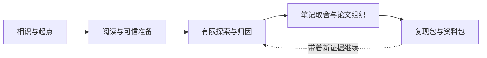

<p align="center">
  <picture>
    <source media="(prefers-color-scheme: dark)" srcset="docs/assets/rondel-hero-dark.svg">
    
  </picture>
</p>

<p align="center">
  <a href="https://github.com/diego20050818/Rondel/releases"></a>
  <a href="LICENSE"></a>
  <a href="pyproject.toml"></a>
</p>

<p align="center">
  <b>中文</b> · <a href="README.en.md">English</a><br>
  <a href="#从一个问题开始">开始使用</a> &nbsp; / &nbsp;
  <a href="examples/guided-init/README.md">相识示例</a> &nbsp; / &nbsp;
  <a href="docs/architecture.md">架构与流程</a> &nbsp; / &nbsp;
  <a href="https://github.com/diego20050818/Rondel/releases/latest">下载技能包</a>
</p>

<br>

## 让每次探索，都留下可以继续的路

Rondel 是一个面向研究者的科研协作 Skill，陪你从模糊的想法走向有证据的认识，再把这些认识整理成论文和可以交付的研究材料。你决定哪些问题值得追问、怎样理解结果，以及何时继续或收束；Agent 协助检索、定位实现、编写代码、核对协议、组织证据和记录重要选择。既有论文库、代码、实验机器和笔记可以直接接入，已经开展的研究从实际进度继续。

“回环诗”寄托着这里的研究观：带着新的证据，回到最初的问题，让理解一轮轮形成结论。我们从广读优秀工作开始，选少量核心论文精读、形成自己的摘要并复现，再围绕有依据的局限做少量修正与归因。研究中的困惑、负面发现和暂存方向，也会留下清楚的位置与重新开始的线索。

## 从一个问题开始

从 [Releases](https://github.com/diego20050818/Rondel/releases/latest) 下载 `rondel-main-0.1.1.zip`，解压后保留完整的 `rondel-main` 文件夹。按使用的 Agent，将它放入下表中的项目技能目录，再确认客户端已经发现技能。辅助脚本需要有效的 Python 3.11+ 解释器，安装包已内置 PyYAML，具体接入方式见对应说明。

| 使用环境 | 项目内安装位置 | 启动方式与说明 |
| :--- | :--- | :--- |
| Codex | `.agents/skills/rondel-main/` | `$rondel-main` · [接入说明](adapters/codex.md) |
| Claude Code | `.claude/skills/rondel-main/` | `/rondel-main` · [接入说明](adapters/claude-code.md) |

```text
第一次用 Rondel，带我开始吧。

我准备开展一个新方向，希望先梳理问题、论文和可行的研究起点。
```

Rondel 会先介绍自己，再从你眼下的科研状态聊起，逐渐了解研究经历、目标与合作习惯。问答结束后，它用一个完整段落反馈对你的理解，凝练一句可检索的领域摘要，并提出可以共同修订的计划与排期。已有项目可以直接说“继续上次的研究”，单项任务也可以从现成材料开始；完整体验见[从相识到研究起点](examples/guided-init/README.md)。

## 一条研究主线，四组协作职责

Main 持续维护问题、计划、证据与研究者当前的状态，Pre、Mid、Post 承接不同的工作重心。阶段有实际的转移目标和评审点，具体任务按当前意图选择，可以跨阶段调用。当前通过一个技能入口提供 **28 个研究工作流**，详细输入、产物与调用位置见[工具目录](docs/collections.md)。

| 职责 | 这段路主要完成什么 | 留下什么 |
| :--- | :--- | :--- |
| **Main · 7** | 相识、恢复、理解状态、复盘取舍与交接 | 画像、主问题、计划、真实选择和下一步 |
| **Pre · 6** | 广读与核心阅读，核对数据、协议、Baseline 和环境 | 领域地图、核心论文、可信比较起点与冻结设置 |
| **Mid · 8** | 从现象形成问题，寻找成熟实现，有限设计、执行与归因 | 关键数据、候选 claim、有效证据与剩余解释 |
| **Post · 7** | 统一取舍笔记，收敛发现，组织图表论文与研究收尾 | 主文与补充、复现包、资料包和继续入口 |



## 把注意力留给值得判断的事

实验期间先保存关键数据、实际条件与候选 claim，最后统一审阅研究笔记，再决定哪些进入主文、补充材料、研究档案或待核验集合。Agent 记录实际阅读覆盖和取舍理由，围绕中心问题组织故事线；影响结论的负面证据和方法代价会保留在相应位置。参见[论文材料取舍](skills/rondel-main/references/paper-material-selection.md)与[完整使用案例](examples/mid-post/README.md)。

工作从正式或成熟来源的真实实现入手，数据、协议、Baseline 与环境以固定版本接续。有限实验清单会核对已有任务、设置引用与尝试预算，运行完成后再检查产物有效性和研究含义。Main 同时关注你的理解、投入与当前阻碍，跟进已经认可的阅读和尝试，在检查点推荐下一项具体行动或有依据的收束。

## 笔记能接续，机器也能各就各位

研究档案统一存放在指定工作区的 `.rondel/`，代码、数据、权重和实验产物保留原有位置。资源记录关联不同机器上的代码、环境、任务和产物入口，实际连接、调度与运行使用当时可用的宿主工具。使用 Obsidian 或其他 Markdown 软件时，可以向选定的可见目录导出阅读与批注视图，保留你的修改并回收讨论。

项目进入时先用脚本检查 `.rondel/`，首次明确启动先保存最小 Init，已有档案再从短提示调用轻量意图识别；随后生成相关上下文包，沿引用与版本找到原始证据。阶段结束时沉淀下一阶段所需的认识与未解项，旧方向和临时细节退出默认加载，并保留检索入口。详见[路由触发与当前表](docs/routing-map.md)、[阶段上下文](skills/rondel-main/references/phase-context.md)和[笔记适配](skills/rondel-main/references/note-adapters.md)。

## 研究结束时，带走两份可以继续使用的材料

**复现包**说明怎样建立环境、获取数据、运行代码并核对结果，记录实际验证到了哪一步。**资料包**留下优先阅读路径、研究者形成的认识、关键选择、有效负结果与开放问题，帮助下一次对话或下一位研究者接续。两份包按明确清单生成，研究回顾与告别放在实际交付之后；参见[收尾示例](examples/research-closeout.md)。

<p align="center"><em>这一次，我们先把走过的路留在这里。<br>等你带着新的疑问回来，我们再从这里继续。</em></p>

## 继续了解

| 想看什么 | 从这里开始 |
| :--- | :--- |
| 第一次使用与完整调用 | [Init 对话](examples/guided-init/README.md) · [全场景案例](examples/usage-cases.md) |
| 前期什么时候结束 | [Pre 退出条件](skills/rondel-main/references/pre-exit.md) |
| 从探索走向收敛 | [Mid → Post 评审](skills/rondel-main/references/mid-exit.md) |
| 当前实现与验证依据 | [实现审查](docs/implementation-audit-20261027.md) · [工程验收](docs/VALIDATION.md) |
| 架构、路由和扩展 | [架构图](docs/architecture.md) · [开发说明](docs/development.md) · [扩展约定](docs/extension-guide.md) |
| 标志与视觉来源 | [回环中的火种](docs/brand.md) |

当前版本为 **0.1.1**，提供研究协作流程、模板与七个本地辅助脚本，完整回归已有 **183 项通过**。这些检查覆盖记录、版本、状态、上下文与交付文件等工程能力，科学判断和对话体验继续通过实际研究材料审阅。项目采用 [MIT License](LICENSE)，欢迎带着具体使用场景、发现的问题或改进建议提交 Issue 与 Pull Request。
