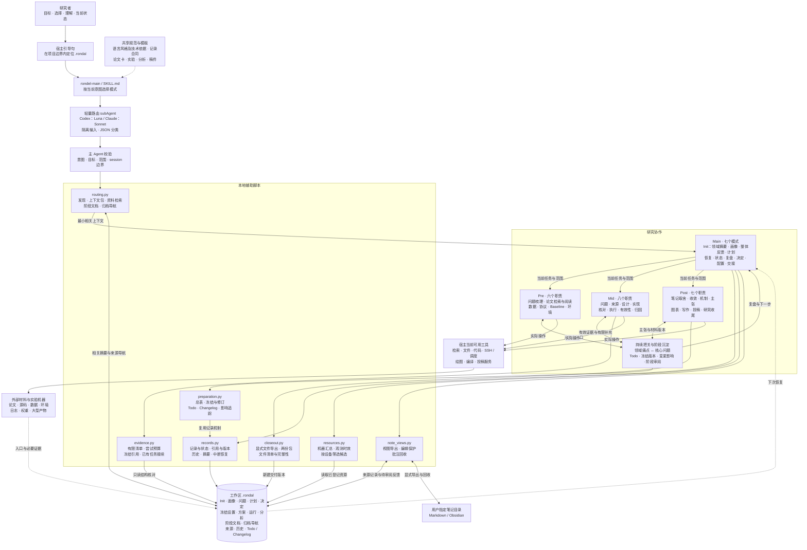

# 项目总览与完整目标

当前架构图展示单个实际技能入口、Main / Pre / Mid / Post 共 28 项职责、共享规范、七个辅助脚本、`.rondal` 档案及外部机器和笔记目录。编辑 [Mermaid 源文件](rondel-architecture.mmd)即可调整图中的关系。流程、记录和上下文辅助随技能发布，实际研究操作通过宿主工具完成。

Rondel 面向本科生和研究生，从研究准备、问题探索和受控实验，延伸到架构收敛、机制与 claim、视觉表达、论文写作和投稿。研究者参与核心问题、方向取舍和科学结论的形成，AI 帮助澄清、查证、比较、实现、分析与记录。主线、候选解释和探索旁支分别保存，每项工作说明它将帮助理解什么。

## 初次接入与持续协作

首次对话以 Rondel 的身份亲切介绍自己、诗体名字的寓意和协作方式，再通过倾听、澄清、材料接入与共同审阅形成 Init。进入相识段落前读取已有档案或 Agent 中的相关可用记忆，先接续已知背景，再核对近况。研究者画像记录用户表达或认可的背景、经验、需求与协作偏好，帮助调整引导深度和节奏，与研究主线分别保存。用户模糊时从具体观察开始，经验充分时直接核对缺口；画像空缺可以在后续对话中补充，已有档案直接恢复。笔记、论文库、代码、数据和机器按用户指定位置绑定，协议、配方、指标和来源在关联记录中展开。

问答结束先交付一个完整的用户理解段落，再提出覆盖近期目标的推荐计划、阶段排期、产出与复盘点，共同修订后接续当前一步。记录统一保存在工作区 `.rondal/`，工作区根目录留给研究本身的文件。Main 从计划位置恢复，完成本轮任务、产物核对与共同复盘，再更新计划和下一步；计划变化保留依据、旧版与用户决定。

Main 的研究主线以广读优秀论文建立领域地图，选少数核心工作精读、形成研究者自己的摘要并复现，再针对有依据的局限做少量修正与归因。研究状态包括客观产物和用户当前的理解、投入、精力与阻碍，分别保留来源。前中后期设置实际退出标准、阶段预算与评审点，主动跟进已认可的阅读和尝试；停滞时缩小行动、定位问题或共同调整路径，并在条件满足时建议前进。

整体流程见 [Main 总流程图](../skills/rondel-main/references/main-flow.md)，工具职责与回传见 [工具映射图](../skills/rondel-main/references/main-tool-map.md)，阶段依据见[状态机](state-machines.md)。

main 恢复上下文、组织主线检查和方向讨论，记录真实用户决定。前期工具核实环境、数据、协议、基线和成熟来源；中期工具从现象形成问题、比较实现、设计实验并在批准范围内执行和分析；后期工具收敛架构、机制与论点，完成图表、论文和投稿准备。详细工具表见 [collections](collections.md)，状态与输入输出见 [state machines](state-machines.md)。

全部流程随 rondel-main 发布，前期按核心阅读、数据与评价协议、基线选择和目标机器环境接续，机器盘点可并行。中期围绕具体问题完成成熟来源核对、有限对照、实现、执行与归因，后期围绕有效证据完成收敛和表达。资源聚合层关联各机器的连接入口、代码、数据、环境、实际运行与产物，并保留观测时效；实验方案、运行与分析分开记录，论文模板围绕主张与证据以及研究者批注组织。

笔记适配层保持 .rondal 主档案，通过用户指定的可见目录提供 Markdown 或 Obsidian 视图。视图平铺属性，保留身份、版本与关联，研究者编辑先回收为待审阅反馈，避免静默覆盖和状态漂移。当前提供文件级导出与反馈捕获，不修改真实笔记库配置，也不实现实时双向同步。

## 实验与证据

实验前写清假设、预期结果、否证条件、对照与资源清单。结果检查涵盖实际协议、产物与覆盖，分析结合主要指标、错误行为、收益损伤和替代解释。成熟模块先核对来源实现及调用端，保持关键机制，适配差异单独登记。工程检查支持实现可用性，研究结论关联相应实验和适用条件。

核心问题、假设、实验、有效运行、来源快照和 claim 通过引用联系。性能、机制、归因和成本发现分别组织，论文围绕中心问题与证据展开，完整探索过程保留在笔记。VISUALIZATION.md 是项目图表语义、统计和视觉语言的统一入口，投稿要求核对官方来源、日期及时区。

## 上下文与实现边界

Main、Pre、Mid 与 Post 当前共用 rondel-main：当前意图选择模式，结构化任务包与阶段文档定位相关资料，完整材料按核验需要读取。Mid / Post 以具体任务引用约束相关记录，有限依赖接续方案、运行、分析与稿件主张，旧任务和共享数据不扩大本轮范围。七个辅助脚本处理本地记录、版本、上下文、资源、笔记视图、有限清单核对与研究包导出，原始数据、权重、论文文件和机器产物留在原处。

## 当前交付与后续验证

当前 28 项职责均有可加载流程与记录约定，Mid / Post 新增配套模板和有限执行辅助核对，并接入现有路由。后续通过真实使用观察科学判断、用户理解、阶段收束与宿主工具衔接，再据实际失败修订。工程验证、行为评估和正式科研结果分别记录，具体检查见 [VALIDATION](VALIDATION.md)。
