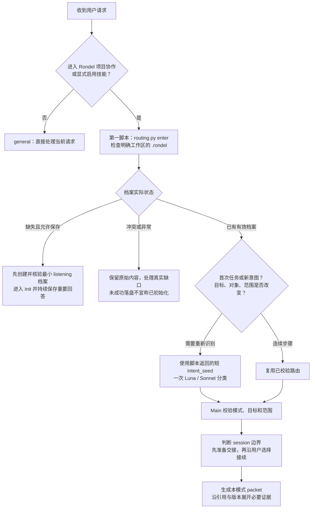

# 当前路由触发与路由表

本图按当前技能指引、shared/tool-catalog.yaml、records.MODE_REFERENCES 和 routing.ROLE_PURPOSES 核对，日期为 2026 年 10 月 27 日。当前有 28 个可用研究模式，加一个 general 兜底，均由 rondel-main 按需加载。触发和意图识别由 Agent 按技能约定编排，Python 负责结构校验、目标约束和上下文组装，当前没有全局消息拦截 Hook。

## 路由何时触发

连续步骤复用的是已经校验的模式与范围，新意图才需要重新委派。目标、对象、只读或执行范围改变时重新核对，旧票据不能覆盖新请求。Rondel 未启用的独立问答直接处理，已启用后识别为 general 时同样不自动载入科研档案。

| 本次变化 | 默认处理 | 研究上下文怎样加载 |
|---|---|---|
| 已有档案的新任务，或目标、对象、意图、范围改变 | 主动调用一次轻量路由，再由 Main 校验 | 按新模式生成包，不复制父会话 |
| 同任务的追问、机械步骤或已确认队列项 | 沿已经校验的路由接续 | 刷新相关记录与版本，需要时补证据 |
| 返回不可用、目标越界、只读约束冲突或关键歧义 | Main 接手或澄清关键一处 | 不执行子 Agent 返回的命令，不反复升级调用 |
| 当前只需独立问答或技能设计 | general | 不自动初始化或读取科研档案，当前请求所需文件仍可按指令接入 |

## 当前路由表

模式选择看当前意图，phase 只帮助判断相关性。下表的记录默认以卡片和导航传入，原文按当前判断需要展开；表中的工作动作由 Main 在有效范围内完成，分类结果本身不执行保存、训练或新建 session。显式目标优先于默认用途卡，阶段简报只取本轮相关部分。

| 模式 | 典型触发 | 本模式定位的信息与接续动作 |
|---|---|---|
| main.init | “第一次用，带我开始” | 称呼、背景、经验、所需支持与表达偏好；渐进访谈后反馈整体理解和计划 |
| main.open | “继续上次的工作” | 当前计划、相关复盘和阶段简报；无阶段简报时定位相关 current 交接 |
| main.status | “现在做到哪了” | 当前任务、阶段、近期用户状态、计划与复盘入口；状态查询保持只读 |
| main.review | “分析结果、复盘方向、评审 Pre 退出” | 指定目标与当前计划、复盘和阶段简报；按证据判断缺口及下一步 |
| main.decide | “就按刚才那份有限方案做” | 当前用户的实际选择、目标对象及范围；保存真实决定并关联对象 |
| main.configure | “修改协作方式、位置或领域摘要” | Init 相关字段与指定目标；重读当前版本后修订，保留其他有效条目 |
| main.handoff | “保存进度、暂停、明确切换 session” | 当前计划、复盘、阶段简报和相关交接；保留有效范围与待续入口 |
| pre.framing | “想法还模糊，先梳理问题” | 准备总表、领域痛点、核心问题及当前主问题；形成可检索和讨论的起点 |
| pre.library | “找论文、精读、定位实现” | 领域地图与核心论文卡；区分 AI 摘要与用户实际理解 |
| pre.data | “找数据集、核对版本和标注” | 数据设置卡；核对样本语义、内容、划分和访问条件 |
| pre.protocol | “核对支持查询、监督或评价口径” | 协议设置卡；按需展开数据、采样和评价实现 |
| pre.baseline | “读完核心论文，选哪个复现” | Baseline 选择讨论和设置卡；核对来源、版本、配方及差异 |
| pre.environment | “看看算力，或在目标机器建立环境” | 机器与环境卡；观测筛选、位置绑定、环境建立和实际核验分别记录 |
| mid.issue | “这个现象究竟说明什么问题” | 当前问题、观察与候选假设；分开实际现象、解释和可检验条件 |
| mid.retrieve | “为这个问题找成熟模块和真实实现” | 当前问题及 method_source；定位版本、调用链、关键机制和适配差异 |
| mid.design | “怎样用少量对照判断增益来自哪里” | 当前假设与 experiment；明确预期、否证、冻结设置、有限清单和预算 |
| mid.implement | “按这份方案落实最小改动” | 指定任务、成熟来源和 implementation_note；对照实际源码保留核心机制 |
| mid.preflight | “先核对能否按这份方案运行” | 当前方案、设置和 preflight；检查批准范围、实际条件、预算与已有作业 |
| mid.execute | “继续这份已确定清单” | 方案关联的 run；接续已有任务，在具体范围内执行并记录真实任务标识 |
| mid.inspect | “这次产物完整吗，协议是否一致” | 指定方案或运行及 run_inspection；区分运行完成与证据有效 |
| mid.analyze | “有效结果支持什么，下一步补什么” | 当前方案关联的有效运行与 experiment_analysis；核对收益、损伤与替代解释 |
| post.converge | “保留哪个版本，哪些补充该停止” | 当前候选与 convergence；保存保留依据、有限补充和停止扩张的条件 |
| post.mechanisms | “把模块作用和机制证据整理清楚” | 指定方法及 mechanism；对齐数据流、干预证据、条件与尚未解释之处 |
| post.claims | “这些结果最多能支持怎样的主张” | 当前 claim 与 claim_evidence；关联证据、局限、反证和实际采用决定 |
| post.visualize | “为这个发现设计并生成图表” | 指定主张、figure_plan 和真实数据入口；统一处理、统计与可编辑产物 |
| post.write | “根据这些证据组织或修改论文” | 当前稿件关联的主张和 manuscript；保持问题到贡献的论证、引用与数值可核对 |
| post.submission | “核对目标要求并准备投稿材料” | 目标及 submission_requirements/package；核对正式来源、日期时区、版本与材料范围 |
| post.closeout | “把这项研究收尾，整理复现包和资料包” | 当前成果及 project_closeout、两个包的范围与实际验证记录；回顾、交付与自然告别，归档沿真实选择 |
| general | “解释独立概念”或“继续设计技能本身” | 不载入科研项目；直接按当前请求处理，不启动 Init |

## 一个模式实际得到什么

项目模式共享少量项目锚点、当前任务、适用表达偏好和来源位置。Main 的恢复、状态、复盘和交接可取当前阶段已审阅 brief 的相关认识；Pre 专项默认只取其中的问题和下一步。默认任务包上限为 6000 字符，最多四张用途卡及八个显式目标，超出内容转为导航，不以截断冒充已读。

前期模式还定位准备总表中的焦点与主问题。数据、协议、Baseline 和环境默认选取当前冻结版本对应的用途卡，必要的候选草案与历史版本按具体目标读取。旧目录名 pre.benchmarks 只保留为 context/normalize 的兼容映射，正式路由统一使用 pre.baseline，不增加一条可用模式。

中后期以显式目标或 next_step 中具体任务引用作为范围，显式目标优先于上次保存的任务。默认沿有限依赖定位方案、运行、分析或稿件关联的主张，共享同一数据设置不会把另一份实验一起带入。缺少具体目标时先定位待选对象，不自动注入项目内全部运行与论点；来源原文仍需按当前判断展开。

## Session 触发是另一层判断

从 pre.data 切换到 pre.protocol 可以需要新的意图识别，但通常仍留在同一 session。跨阶段、新项目、独立主问题或旧上下文已经干扰工作时，Main 先准备接续包，再给出建议；用户选择继续后，同一边界不反复提醒。新会话默认从空白上下文加交接包接续，轻量路由子模型不替换主任务模型。

## 例子

| 用户表达 | 本轮路由 | 需要新 session 吗 |
|---|---|---|
| “先别实验，只核对支持集与查询集” | pre.protocol，保留只读范围 | 同一问题内通常继续 |
| 写作阶段说“再找几篇机制相关论文” | pre.library，phase 不覆盖意图 | 通常继续 |
| “旧方向当时为什么暂存” | main.review，显式查询归档 | 通常继续 |
| “另开一个独立项目” | 按接入目标选择 main.init/open | 主动建议分开，明确要求后落实 |
| “同一个方案继续看下一条” | 复用已校验模式与范围 | 继续 |

进一步规则见 [路由指引](../skills/rondel-main/references/router.md)、[轻量 subAgent](../skills/rondel-main/references/subagent-router.md)、[session 边界](../skills/rondel-main/references/session-boundaries.md)和[工具目录](../shared/tool-catalog.yaml)。本图解释当前机制，不改变实际研究阶段或宿主全局配置。
