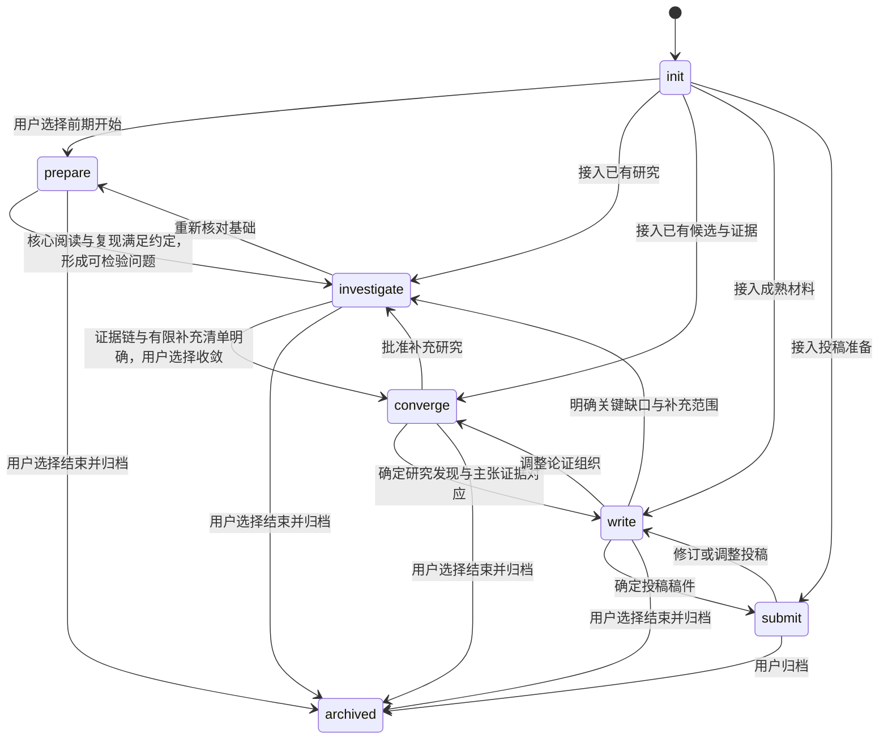

# 状态机与决定来源

状态分别附着在项目、问题、方向、假设、实验、运行和 claim 上。项目阶段表示关注点，活动状态表示当前协作情况；运行完成后，还需核对产物与研究含义。对象转换保存事件、理由和来源，人的决定与自动核验分别标记。

## 项目阶段

项目 activity 为 working、awaiting_user、waiting_for_resource 或 paused。阶段变化与主线确认需要真实用户来源。Init 的 listening、clarifying、grounding、reviewable、ready 可以根据材料充分程度往返或跳过，ready 标明适合探索、设计、执行准备或写作；它不会启动任务。

用户可从任何阶段，包括尚未完成 Init 的项目，明确选择结束并归档，原记录、未解项与已有任务保持真实状态。收尾交付使用 [post.closeout](../skills/rondel-main/references/post-closeout.md)，文件导出不会触发阶段变化。归档允许负结果、提前结束和资料型成果，不能借此推断已投稿、已发表或全部问题已解决。

reviewable 阶段交付一个完整的用户理解段落与推荐计划排期。用户认可适用计划并选择当前一步后，记录 `next_step.plan_ref` 及决定来源，再按实际准备程度进入 ready。Main 沿“当前任务、产物核对、共同复盘、计划更新”循环推进，阶段不因时间经过而自动变化。

前期对应 prepare，重点是领域地图、少数核心论文的精读与用户摘要、成熟实现和约定范围的复现。中期对应 investigate，围绕有依据的局限做少量修正、匹配对照与归因，形成范围明确的认识。后期包含 converge、write、submit，依次完成研究发现与方法收敛、证据组织与全文、正式投稿准备；已有项目按实际依据从相应位置接入。

各阶段的具体退出标准与推进手段见 [Main 研究主线](../skills/rondel-main/references/main-research-loop.md)。达到条件时主动提出转移建议，缺口明确时安排有界补充，沿实际用户选择或仍有效的条件性决定更新。阶段预算与检查点用于触发审阅和取舍，不能代替科学证据。

## 用户状态与推进状态

Pre 的正常退出按 [六项条件与交互](../skills/rondel-main/references/pre-exit.md) 审阅，区分准备证据、评审结果与用户实际决定。pre_review_tasks_complete 排除阶段复盘本身，checklist_complete 包含它；清单未齐也可以召开评审，形成有界补充、调整问题或暂停。带入中期的待办保留真实状态，用户明确提前转阶段时记录未解决条件与有限首项任务。

用户的近期理解、困惑、投入与精力来自自述或实际讨论，与客观产物和长期画像分别保存。已认可的阅读、摘要、复现与思考形成当前承诺，Main 在约定检查点核对，并按 [状态与推进](../skills/rondel-main/references/main-state-and-momentum.md) 处理延后与阻碍。默认连续两次约定工作复盘缺少实质推进或阶段评审点到期时，必须提出改变做法的一项行动和新检查点；次数可调整，普通状态查询与正常等待不累计为停滞。

Main 复盘与阶段审阅使用讨论记录并关联实际来源。当前脚本校验结构、状态边与人的来源，不自动判断是否真正读懂论文，也不根据记录中的情绪或时间强制推进阶段。用户状态用于调整支持与任务大小，科学条件根据实际证据共同判断。

## 科学对象

| 对象 | 主路径 | 人的选择点 |
|---|---|---|
| 问题 | observed → clarified → active → resolved / parked | 当前重点、问题解决 |
| 方向 | exploring → provisional → confirmed → revisiting | 共同确认、重新讨论 |
| 假设 | proposed → testable → selected → examined | 选择检验假设 |
| claim | candidate → evidence_linked → reviewed → adopted / held / withdrawn | 正式采用或撤回 |

假设评估另外记录 unassessed、supported、weakened 或 unresolved，并附具体条件、有效证据和共同审阅记录。新证据影响 adopted claim 时进入 needs_review，再补证据与审阅。引用记录的存在是结构条件，科学支撑程度由相关工具与研究者核对。

## 实验方案

draft → reviewable → approved → preparing → ready → executing → ready_for_analysis → reviewable_result → closed。批准前要求假设、预期、否证条件和 scope，批准状态保存当时范围；范围变化应建立新版本或新方案，旧实验保持。方案关闭保存人的阶段取舍。

运行 planned → preparing → ready → queued / running → completed，实际错误和中断记录为 failed 或 cancelled。运行产物另有 unchecked、valid 或 invalid 的检查状态，有效性判断需要对应检查证据。失败尝试保留，重试创建关联记录，避免覆盖旧运行。

Mid 按 [问题到归因的循环](../skills/rondel-main/references/mid-cycle.md) 接续这些状态，`mid.inspect` 核验产物和协议，`mid.analyze` 使用有效范围内的证据更新认识。新方案的 scope.run_keys 固定有限运行清单，默认每项一次尝试，总尝试预算单独确定；run 保存 experiment_ref、run_key 与 attempt。只有前次失败、取消，或完成后有检查依据标为无效，才可在剩余预算与原范围内登记重试；已有待运行和活动任务直接接续。

中期退出使用 phase_review、review_type: mid_exit，按 [六项转移条件与交互](../skills/rondel-main/references/mid-exit.md) 核对发现、有效证据与归因、可接续版本、研究者理解和有限清单。正常转移是 investigate → converge，目标是围绕可信候选发现开始收敛，写作条件继续单独审阅。Post 的收敛与投稿就绪审阅分别用 post_convergence、submission_readiness，沿 [后期链路](../skills/rondel-main/references/post-cycle.md) 组织方法版本、主张证据、稿件和正式要求；阶段文档按相关性沉淀与归档，状态更新沿真实用户选择。

## 文件操作与恢复

记录修改使用当前内容摘要，保留文件历史并追加状态事件。发生写入中断时，pending 日志可通过 recover 显式完成；若出现后续人工修改，先核对差异。只读的 status/context/validate 不重建索引，索引变动通过明确的 reindex 操作处理。
