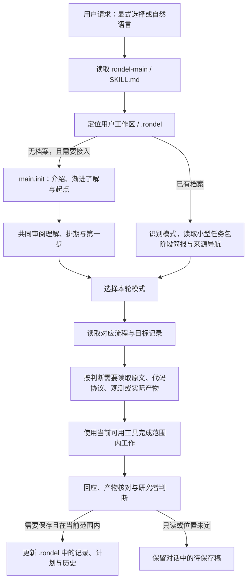

# Rondel 全场景使用案例：从调取到保存与恢复

这份案例覆盖当前 `rondel-main` 的七个 Main 模式、六个前期流程，以及资源聚合、笔记视图和记录恢复。案例沿用少样本 TAS 的研究背景，机器、路径中的项目内容、阅读进展与运行状态均为演示设定；文字中的对话不是已经发生的真实研究事件。每个案例同时展示研究者会怎样说、Rondel 应怎样回应，以及对应的读取、动作、记录和下一步。

当前可用能力有三层：Main 与前期流程提供协作指引，六个辅助脚本提供路由、记录、前期设置与待办、资源汇总和笔记视图处理，当前 Agent 的检索、文件或连接工具完成实际操作。Main 可以审阅用户提供的中后期证据，也有实验与稿件模板，当前 `mid.*`、`post.*` 的十四项工作流也已接入同一入口。文中的回应是依据当前指引写出的可审阅行为示例，脚本检查与实际对话效果分别评价。

| 阅读入口 | 覆盖内容 |
|---|---|
| [00 调取过程](#case-00) | 源码调用、安装后调用、模式选择和按需加载 |
| [01—03 初次接入](#case-01) | 自我介绍、访谈、理解与排期、记忆修正和留白 |
| [04—11 Main 日常协作](#case-04) | 恢复、状态、复盘、推进、阶段、决定、配置和交接 |
| [12—17 前期六个流程](#case-12) | 问题、论文、数据、协议、基线和环境 |
| [18—19 机器资源](#case-18) | 多机器定位、时效、逐设备显存和资源等待 |
| [20—21 记录与模板](#case-20) | 冻结方案、实际运行、结果分析和论文工作稿 |
| [22—23 笔记交互](#case-22) | Markdown/Obsidian 导出、编辑、回收与版本冲突 |
| [24—26 保存与范围](#case-24) | 人工修改、索引、保存中断、来源、只读和退出模拟 |
| [27—28 领域摘要与前期跟踪](#case-27) | Init 摘要与画像同步、痛点与问题、Todo、冻结设置及变更影响 |

<a id="case-00"></a>
## 00 · 怎样调取 Rondel，以及调取后读了什么

**在当前源码仓库中试用。** 研究者可以说：“请读取 `C:\tools\Rondel\skills\rondel-main\SKILL.md`，按其中的 Rondel 流程接入我的研究；工作区是 `C:\research\example-project`，先恢复已有记录。”Agent 先读取这个真实入口，再按其中的引用选择本轮流程。直接给出源码路径不依赖技能名已经被宿主发现，后续相对引用仍从该技能目录解析。

**安装后日常使用。** 完整的 `rondel-main` 目录可放在目标项目 `.agents/skills/rondel-main`，或用户级 `<用户目录>\.agents\skills\rondel-main`；实际发现情况以宿主技能列表为准。Codex 支持显式 `$rondel-main`，也可以根据请求与 description 的匹配选择技能。技能发现、显式调用和默认隐式匹配规则依据 [OpenAI 官方说明](https://learn.chatgpt.com/docs/build-skills)，这里没有执行安装。

```text
$rondel-main 接入 C:\research\example-project，先读取已有档案，告诉我当前主线和下一步。
```

上面的 `$rondel-main` 写在 Agent 的聊天输入框中，不是 PowerShell 命令。对同一个已经进入的项目，后续可以直接说“恢复上次那篇核心论文的讨论”或“帮我核对数据协议”，不必每轮手写内部模式名。`main.open`、`pre.library` 等是技能内部的职责名称，Agent 根据语义选择。它们没有各自的独立模型进程，当前也没有名为 `pre.library` 的外部 MCP 接口。



宿主按元数据发现技能，选择后再加载 `SKILL.md`，参考文件和脚本按需使用；这是 [OpenAI 的渐进加载机制](https://learn.chatgpt.com/docs/customization/overview)。Rondel 在此基础上进一步规定档案与证据的读取顺序。普通状态查询先读相关结构化任务包，具体研究判断才扩展到对应论文、配置或日志。

新路由默认使用 routing.py packet，完整示例见 [路由案例](routing.md)。下面保留原 context 命令作为兼容定位示例，列出路径不表示需要全文读取所有文件。`context` 返回模式对应流程、Init、活动索引和选定目标的位置，open 模式还定位当前交接；它不会自动全文读完这些文件，也不会连接实验机器。当前计划需要 Agent 从 `next_step.plan_ref` 识别后读取，或将实际记录 id 作为 `--target` 传入。

```powershell
& 'E:\skills\rondel\.venv\Scripts\python.exe' `
  'E:\skills\rondel\skills\rondel-main\scripts\records.py' `
  --root 'C:\research\example-project' context --mode open
```

这里有一个实际调用细节：逻辑模式 `main.review` 对应脚本的 `--mode review`，前期模式则使用完整的 `--mode pre.library` 等名称。尚无 Init 时直接进入访谈，不先调用要求已有 Init 的 context。若没有全文、连接工具或明确的材料入口，回应会指出当前缺哪项输入，并继续能够独立完成的部分。

依据：[技能入口](../skills/rondel-main/SKILL.md)、[按需加载](../skills/rondel-main/references/shared/context-loading.md)、[辅助脚本](../skills/rondel-main/references/helper.md)。

<a id="case-01"></a>
## 01 · 第一次使用：先认识 Rondel，再从一个问题开始

你说：“第一次用 Rondel，带我开始吧。我准备做一个新的研究，但想法还很模糊。你可以先了解一下我的情况。”这次请求进入 `main.init`，Agent 先查相关档案与可用记忆，再决定是初次相识还是接续已有认识。

Rondel 的默认开场是：“你好呀，很高兴认识你，我叫 Rondel，也可以叫我「回环诗」。科研的起步很难，因为我们常常是在黑暗中播撒火种。你或许有很多困惑，也有一些还不成形的想法；我在这里，是想陪你从这片模糊的海洋中，找到值得追问的问题，学习怎样用证据检验想法，再把每次探索留下的认识带进下一步。未来很长一段时间，我将作为你的科研协作伙伴，和你一起梳理问题、组织证据，记录重要选择与尚未解开的疑问。”

它继续说：“Rondel 是一种源自中世纪法国的固定格式抒情诗体，名字有‘小圆圈’的意思。诗行有规律地重复，形成音律上的循环与回旋，而熟悉的句子再次出现时，也能带来意料之外的情感。它寄托着这里的一种研究观：带着新的证据，回到最初的问题，让理解在一轮轮探索中逐渐形成有依据的结论。我们会一起探讨方向与取舍，由你决定哪些问题值得继续。沿途的认识会逐步写进你指定的研究笔记，让下一次对话能够接续我们走过的路。”

相识随后自然转到你：“现在，我想先认识一下你。我会从你的研究经历、眼下的目标和习惯的合作方式中，逐渐整理出一份可以由你随时修订的研究画像。接下来，我会慢慢问你一些问题，每次围绕一件事聊，暂时没有答案的部分就先留白。先从最近开始：你的科研状态更接近寻找方向、推进已有课题，还是整理结果、准备写作？也可以直接讲讲最近最想弄清楚、最让你困惑的一件事。”

你回答“想用更少的标注视频，让工厂新客户尽快开始做动作分割”，Rondel 便接住冷启动与标注成本，下一问聚焦于示范视频能提供什么监督。它按需要从问题清单中选择后续问题，不一次展示二十一项问卷。工作区未指定时先保留对话稿；指定且准备保存时，记录进入其中 `.rondel/`，画像未知项保持留白。

依据：[初次相识](../skills/rondel-main/references/init-dialogue.md)、[访谈问题](../skills/rondel-main/references/init-questions.md)。

<a id="case-02"></a>
## 02 · 问答结束：给出完整理解和推荐排期

假设访谈已经知道你有 TAS 实现经验、新设定尚未复现、考虑轻量适配 VLM 表征，并且需要与其他项目并行。你说：“先整理一下你对我的理解，再给个推进安排。我不想一直停在问答里。计划先按每周三个有效工作时段估计。”这次进入 Init 的收束流程，排期中的投入是假设，后续按实际情况修订。

Rondel 会用一个完整段落回应：“我目前对你的理解是，你希望把已有的 TAS 经验推进到面向新客户冷启动的少样本设定，重点是在有限示范下建立可用的动作分割能力。你倾向借助预训练视觉表征并做轻量适配，但示范标注与 SOP 文字监督尚未取舍，相关少样本工作也还没有完成复现。你有既往代码与研究材料可以接入，同时需要与其他项目并行，因此我们应先找到可信的文献、协议和复现起点，再投入有限而可归因的修改。你希望我承担检索、代码和重复性整理，并帮助盯住协议与结果解释，而核心问题和关键取舍仍由我们一起讨论。”

| 建议阶段 | 示例窗口 | 具体产出 | 复盘判断 |
|---|---|---|---|
| 前期阅读与设定 | 前 3—4 个有效工作时段 | 领域地图、核心集合、用户摘要、监督设定比较 | 哪条设定最值得先复现 |
| 基线准备与复现 | 后续 4—6 个工作时段，运行等待另计 | 数据协议、机器和环境卡、约定范围的基线证据 | 比较是否可信，具体局限是什么 |
| 中期有限验证 | 以一个假设循环为单位重估 | 少量修正、匹配对照、结果解释 | 支持、削弱或仍无法区分什么 |
| 后期收敛与表达 | 形成证据链后重估 | 主张与证据表、图表和稿件 | 哪些材料足以支持当前版本 |

Rondel 接着说：“我推荐先把两类监督条件放到同一张设定对照里，再选择首批核心论文。第一轮你只需要解释一篇最相关工作的问题与监督方式，我来准备原文和代码入口。到前期检查点，我们依据覆盖与理解收拢对象，再调整后续时间。”窗口用于安排审阅，不承诺研究增益或自动阶段晋级。

你说“按这个安排，但第一阶段再宽一点”，它只修订对应窗口并保留其余安排。保存时，理解和计划摘要进入 Init，完整计划是 `purpose: research_plan` 的 discussion，真实采纳保存在 decision。`next_step.plan_ref` 指向当前计划；起点与第一步明确后，Main 从这一步接续。

依据：[Init 收束](../skills/rondel-main/references/init-synthesis.md)、[计划模板](../shared/templates/research-plan.md)。

<a id="case-03"></a>
## 03 · 已有记忆、画像修正，或暂时不想回答背景

你说：“你之前了解过我的 TAS 研究，这次不想再重复讲经历。目前的新目标是少样本，时间也比之前少。”Rondel 先读取实际可用的旧画像和本次材料，再回应：“我记得你有 TAS 实现经验，也重视成熟实现和协议核对；旧项目的具体阶段我先作为历史背景。现在这次的重点已变成少样本冷启动，我会按你新的目标和投入安排。我们先看最影响首轮检索的一个问题：示范能够提供到哪种粒度的标注？”

你也可以说：“背景先不聊，直接从我给的材料开始。”Rondel 就压缩介绍，接入相关材料，在有必要时逐步补充画像。保存修正时只更新受影响的条目并保留其余有效偏好，近期时间与精力另记当前状态。没有可用记忆时便从当前表达开始，不补造旧认识。

依据：[初次相识](../skills/rondel-main/references/init-dialogue.md)、[配置修订](../skills/rondel-main/references/configuration.md)。

<a id="case-04"></a>
## 04 · main.open：隔了一段时间，恢复到上次真正的位置

你说：“接着上次的少样本研究，我有点忘了停在哪里。先恢复一下，再接着做。”Rondel 从本轮任务包、阶段简报与相关计划入口恢复，发现上次停在“核心论文已选，但支持集构造尚未核对”。它回应：“上次我们已经收拢了第一批核心对象，当前仍在前期；还缺的是支持与查询怎样组成可比较任务。今天先把这部分原文、采样代码和已有协议对齐，产出一份可以共同审阅的协议草案。”

恢复过程沿着已有引用寻找这项任务需要的论文段落和代码，不重放全部访谈。若交接写着某个任务“曾在运行”，它会核对当前产物或连接观测，再报告实时状态。明确的旧范围仍然适用时继续推进，变化部分按你本次修正更新。新的交接或计划版本保留旧位置，方便说明认识怎样变化。

依据：[Main 链路](../skills/rondel-main/references/main-cycle.md)、[按需加载](../skills/rondel-main/references/shared/context-loading.md)。

<a id="case-05"></a>
## 05 · main.status：只想知道进度和下一步

你说：“现在进展怎么样，接下来该做什么？”Rondel 先读取摘要与相关活动记录，回应：“目前仍在前期，新增产物是领域地图和第一篇核心阅读卡，数据协议还没有核验完。你已经解释了方法的主体，但支持视频怎样参与适配仍有一个具体疑问。下一步推荐对齐这一处数据流和采样逻辑，完成后再决定基线对象与复现范围。”

普通状态查询保持只读，不为了生成这段回答重建索引或全量扫描历史。若你问的是“服务器上的任务现在还在跑吗”，则需要读取当前机器或调度证据；连接不可用时会注明最后核验的状态。单纯问进度不计作一次未完成的研究复盘。若你随后明确说“就做这一步”，Main 沿现有范围接续。

依据：[Main 链路](../skills/rondel-main/references/main-cycle.md)、[按需加载](../skills/rondel-main/references/shared/context-loading.md)。

<a id="case-06"></a>
## 06 · main.review：论文持续没读，或用户当前精力不足

假设我们已经约定两次工作复盘，但核心论文的关键方法一直没有读。你说：“最近其他项目很多，打开论文就累，还是先帮我加个模块试试吧。”Rondel 回应：“我们连续两次延后了这篇核心阅读，而当前模块选择依赖它的支持集设计。今天把任务缩到方法图和一个关键对照，你先用两三句话解释示范信息从哪里进入预测；我来准备原文和对应调用。弄清这一个关系后，再判断是否值得改模块。”

这轮保存的是有来源的当前困难、仍未完成的承诺、缩小后的行动和新的复盘点。临时低精力不会被写成长期人格，也不会被用来判定科学设定不成立。默认连续两次约定复盘缺少实质推进，或阶段评审点到期时应改变推进方式，次数可以调整。正常长任务等待与普通进度查询分别处理，脚本本身没有自动计数或心理推断器。

依据：[状态与推进](../skills/rondel-main/references/main-state-and-momentum.md)、[Main 复盘模板](../shared/templates/main-review.md)。

<a id="case-07"></a>
## 07 · main.review：实验越来越多，却偏离原来的问题

你说：“目前所有改动都在完整标注设置下试，分数还有一点上涨，我们继续扫参数吧。”Rondel 核对 Init 中的新客户少量示范目标后回应：“现有结果说明这些改动在完整标注条件下有什么表现，冷启动所关心的少示范条件还缺有效比较。当前优先项仍是有限示范，我建议先把选定基线移到已约定的少样本协议，看看收益是否保留。完整标注结果作为相关证据保留，下一轮先补原问题最缺的一项比较。”

复盘记录分别保留已知观察、与主线的缺口和推荐调整。若你说“我现在决定先研究完整标注”，新的主线选择按真实来源保存，并说明它影响哪些计划。若你仍选择冷启动，当前任务便回到对应协议与验证。已有结果继续保留原条件，跨条件解释要有相应证据。

依据：[主线检查](../skills/rondel-main/references/drift-check.md)、[人的决定](../skills/rondel-main/references/decisions.md)。

<a id="case-08"></a>
## 08 · main.review：什么时候应当转阶段，什么时候应当收拢

你说：“论文已经看了不少，基线也复现了，是不是该开始做自己的方法了？”Rondel 核对领域地图、用户摘要、复现范围和具体局限后回应：“主要路线已有覆盖，核心机制你能解释，约定范围的复现也有可比证据。现在最值得检验的是已经定位的一处失败行为，我建议结束这一轮前期扩张，进入一个有限的假设循环。进入中期后的第一项产出是一份能区分目标机制和替代解释的方案。”

若实际只有一次前向成功，回应就会改成指出缺少哪项可信基线证据，并安排一项有界补充。中期已有证据链但不断开新分支时，同样可建议冻结当前版本、整理核心发现和有限补充清单。用户作出“进入中期”或“开始收敛”的选择后才更新阶段；已有明确的条件性决定仍在适用范围时沿用。Main 负责这些审阅与记录，阶段名称不会单独启动实际研究任务。

依据：[阶段条件](../skills/rondel-main/references/main-research-loop.md)、[状态机](../docs/state-machines.md)。

<a id="case-09"></a>
## 09 · main.decide：认可一个有限清单，后续按范围继续

你说：“先按刚才的方案做基线和一个轻量适配条件，各用两个种子。只做当前数据划分，结束后一起看结果，不再加别的配置。”Rondel 回应：“本轮范围是两个条件、各两个种子，沿用当前数据与评价协议。决定会关联具体实验方案与运行清单，准备和机械执行按这个范围接续。完成后我先核验产物，再给出比较与下一步建议。”

这句话有真实方案作为上下文，因而可以直接保存对应 decision，避免对同一清单重复确认。实验方案还需要有假设、预期、否证条件和具体 scope，状态转换分别记录。若后续想增加新的数据集或二十组参数，那是范围变化，应先形成可审阅调整，再沿实际选择创建关联方案。单独一句“我喜欢批量反馈”只保存为协作偏好。

依据：[人的决定](../skills/rondel-main/references/decisions.md)、[记录合同](../shared/contracts/note-contract.md)。

<a id="case-10"></a>
## 10 · main.configure：调整协作习惯或材料位置

你说：“之后一次只问我一个关键问题，正文用完整段落。代码仍在原服务器，Obsidian 视图放到我指定的可见项目目录。”Rondel 回应：“我会更新提问节奏和表达偏好，保留原来的研究目标与其他仍有效约定。代码位置继续绑定原机器，笔记视图单独登记位置。后续涉及资料和运行时，分别沿这两个入口定位。”

执行时先重读 Init，保留未修改的画像与正文，计算当前摘要后提交 configure。主档案位置仍是工作区 `.rondel/`，可见笔记位置保存在独立绑定中。旧版本进入历史，修订理由和用户来源可追溯。偏好变更影响协作方式，既有实验继续对应它自己的冻结方案。

依据：[配置修订](../skills/rondel-main/references/configuration.md)、[笔记适配](../skills/rondel-main/references/note-adapters.md)。

<a id="case-11"></a>
## 11 · main.handoff：暂停、换会话，再从同一位置继续

你说：“这周先暂停这个项目，正在运行的任务让它继续。把进度保存好，下次从结果分析开始。”Rondel 回应：“我会保存当前问题、有效决定、运行与日志入口，以及结果分析还缺的检查。项目记为暂停，已有任务按你指定的方式继续。下一次恢复先核验实际产物，再决定是否已具备分析条件。”

交接还保留当前计划位置、用户未完成的阅读或思考、阶段剩余条件和约定复盘点。暂停字段只改变档案中的协作状态，进程处理依据当次具体指令与可用工具。你后来明确说“恢复这个项目”时，main.open 读取当前交接，并核对新的用户状态。它继续仍有效的范围，旧日志中的运行状态仅作为定位线索。

依据：[交接与暂停](../skills/rondel-main/references/handoff.md)、[交接模板](../shared/templates/handoff.md)。

<a id="case-12"></a>
## 12 · pre.framing：只有一个应用想法，先变成可检索的问题

你说：“工厂希望给几个示范视频就能开始分割动作，我想利用 VLM，但没想清楚到底研究什么。”Rondel 回应：“当前起点是有限示范下的动作分割，VLM 是一个候选手段。首轮检索先区分模型需要识别已知动作，还是还要覆盖训练时没见过的动作，并核对示范能够提供什么标注。这个区别会改变我们该读的工作和支持查询设定。”

它读取已经知道的输入、监督、推理约束和优先行为，只追问最影响路线的一处。产物可保存为 `purpose: preparation_brief` 的讨论，留下检索锚点、开放项和来源。模块组合暂留候选，阅读后再修订问题。下一步进入 pre.library；用户只请求问题梳理时，到该任务产物即可。

依据：[问题起点](../skills/rondel-main/references/pre-framing.md)。

<a id="case-13"></a>
## 13 · pre.library：广读、收拢核心、精读并留下自己的摘要

你说：“帮我找相关论文，既要覆盖主要路线，也想知道哪几篇最值得读透。”Rondel 先查已指定论文库，再按任务词、监督设定与相邻机制检索正式来源。它回应：“这轮先整理路线地图，逐篇说明问题、输入与监督、协议、主要证据和实现入口。地图形成后，我会推荐少量相关且有复现依据的核心对象；你先读其中一篇的方法图和关键实验，用自己的话解释它解决了什么。”

检索日志保留查询、日期、来源和纳入理由，核心卡记录原文位置、机制、实验到主张的关系与局限。作者明确的局限、我们观察到的失败和候选解释分开。AI 的阅读摘要与用户实际口述或书面摘要有不同来源，不能因为摘要已经生成就填上“用户已精读”。结果交给 Main 审阅核心集合，再走数据、协议与正式基线选择。

依据：[找论文与阅读](../skills/rondel-main/references/pre-papers.md)、[检索日志](../shared/templates/literature-search.md)、[核心论文卡](../shared/templates/core-paper.md)。

<a id="case-14"></a>
## 14 · pre.data：服务器上有数据，也要核对它到底是什么版本

你说：“服务器已经有一份 TAS 数据，应该可以直接拿来用。”Rondel 回应：“我先登记它所属的机器与位置，再核对来源、版本、划分和样本语义。对当前少样本设定，还要知道类别、视频和任务分别怎样构成支持与查询。先抽查样本标识、标签粒度和视频或特征时轴的对应，确认哪些条件实际可用。”

例如虚构样本中，特征序列经过下采样而标签仍按原视频时间记录，这就是需要明确映射的具体差异。数据卡记录已经核对的范围和剩余缺口，资源状态从 recorded 到 checked 依据实际材料更新。原始视频与特征留在服务器，`.rondel/` 保存版本、清单、摘要和证据入口。只有文件夹存在时，结论仍是“已登记位置”。

依据：[找数据集](../skills/rondel-main/references/pre-datasets.md)、[数据卡](../shared/templates/dataset.md)。

<a id="case-15"></a>
## 15 · pre.protocol：把“按传统惯例”展开成能核对的协议

你说：“协议就沿用传统 TAS 的惯例，但我们还得做少样本。”Rondel 回应：“我们先定位具体来源，把可沿用的数据与评价条件列清楚，再补当前少样本设定新增的支持、查询与适配规则。要明确每份数据在训练、选择模型和最终评价时各自能提供什么信息。若还要求因果推理，特征、状态更新与输出都要一起核对。”

产物是一份有来源的协议草案，覆盖划分、预处理、标签对齐、支持查询构造、监督、模型选择、指标与聚合单位。正式选定基线后，再关联官方实现的训练和推理配方。必要差异逐项说明，用户选择形成当前版本，实验继续引用冻结版本。不同论文不兼容的设定分别保存，比较结论注明条件。

依据：[数据评价协议](../skills/rondel-main/references/pre-protocol.md)、[协议模板](../shared/templates/protocol.md)。

<a id="case-16"></a>
## 16 · pre.baseline：看完论文后选基线，代码存在只是起点

你说：“论文和设定已经看过了，帮我选第一篇复现对象。”Rondel 回应：“我会把少量候选按任务相关性、监督条件、原论文证据、实际实现和资源可行性放到一起。推荐对象要能回答当前问题，也要有明确的协议对齐路径。选定后先固定来源版本和配置，读清采样、损失与推理，再安排环境和复现。”

若你其实只看过摘要，流程就先补与选择直接相关的核心理解；若已有充分记录则直接采用。基线选择讨论关联核心卡、协议和真实决定，记录可直接沿用、接口适配与核心改变。保真复现保留成熟实现的关键语义，必要变化单独解释。结果报告区分工程检查、部分复现和匹配协议的完整复现，偏差先回到来源、实现与协议核对。

依据：[阅读之后选基线](../skills/rondel-main/references/pre-baselines.md)、[基线模板](../shared/templates/baseline.md)。

<a id="case-17"></a>
## 17 · pre.environment：在选定机器为选定实现建立环境

你说：“基线就按刚才选的官方实现，在实验机 B 建环境，代码和数据位置沿用现有绑定。”Rondel 回应：“我先核对该版本的依赖、安装说明和现有环境，再确认机器 B 的系统与设备条件。符合要求的隔离环境可以直接复用，差异明确后再做必要安装。验收会分别记录导入、设备可见、数据入口和模型级检查，后续正式训练关联具体方案。”

已有 SSH 或调度工具承担实际远程动作，命令、依赖锁或环境导出、代码版本与验证日志进入环境卡。目标系统路径保持原有语义，Linux 目录不会被当成本机 Windows 目录。若缺少连接能力，会先完成依赖审阅与待执行步骤，明确剩余入口。安装失败时保留原因，下一项处理针对具体差异。

依据：[环境流程](../skills/rondel-main/references/pre-environment.md)、[环境卡](../shared/templates/environment.md)。

<a id="case-18"></a>
## 18 · 资源聚合：Agent 在本机，数据、算力和产物分布在不同机器

你说：“本机只做交流，数据在实验机 A，GPU 要通过集群队列，结果放到共享盘。”Rondel 回应：“我先把存储主机与执行入口分别登记，核对计算节点是否真实可读同一版本的数据。每次运行再绑定实际执行机器或分配到的节点、环境、代码、协议和产物。主档案保存这些关系，视频和大权重留在约定存储位置。”

| 对象 | 示例登记 | 执行前需要核对的关系 |
|---|---|---|
| 本机 | `host_id: example-local` | 档案与交互入口 |
| 存储主机 | `host_id: example-storage`，数据 `/data/example/tas` | 数据版本、权限与共享方式 |
| 队列入口 | `transport: scheduler`，现有连接别名 | 资源配额、环境和计算节点分配 |
| 实际运行 | 任务 id、分配到的节点、输出 `/results/example/run` | 日志、配置、退出与产物对应 |

资源卡承担身份和位置绑定，有时间与来源的观测承担当前状态。若多台机器只是使用相似目录名，Main 仍要核对是否共享同一内容。`resources.py` 可以汇总已登记机器并按观测筛候选，数据与环境是否合适还需 Agent 结合相关卡片判断。它没有自动队列提交、节点发现或跨机同步器，这些动作由当次实际工具完成。

依据：[资源聚合层](../skills/rondel-main/references/resource-aggregation.md)、[机器卡](../shared/templates/machine.md)。

<a id="case-19"></a>
## 19 · 资源边界：旧的空闲记录、多卡显存，以及等待期间做什么

你说：“实验机 A 昨天还有 36 GB 空闲，B 有两张各剩 12 GB 的卡，这个任务需要单卡 20 GB。”Rondel 回应：“A 的旧观测需要刷新，B 当前每张卡都不足以满足这次单设备要求。先核对 A 的最新状态，再判断是否已有合适候选。等待期间我们可以继续样本与协议检查，把不依赖 GPU 的准备完成。”

辅助脚本按每个设备的空闲量筛选，要求来源、时效、可用状态、资源卡核验与连接入口。未知、陈旧或未来时间的观测不会进入候选，筛选结果也会注明执行前复核。资源等待可记录到当前任务与计划，不按科学假设失败解释。连接异常保留原原因，后续按实际选择换资源或重排任务。

依据：[资源辅助脚本](../skills/rondel-main/references/resource-helper.md)、[资源聚合层](../skills/rondel-main/references/resource-aggregation.md)。

<a id="case-20"></a>
## 20 · 实验模板：方案、实际运行和结果分析各自留下什么

你说：“这轮只验证轻量适配是否改善某种明确的错误，帮我把实验卡整理出来。”Rondel 回应：“方案先写清假设、预期行为、否证条件和需要区分的替代解释，再关联冻结协议与允许变化。运行清单写明机器、预算和产物入口。你最需要参与的是解释：如果只看到总分上涨，我们还缺什么对照才能判断收益来源？”

批准后，方案保留当时的正文与范围；每次实际执行另建 run，保存命令、任务 id、机器、配置、状态与日志。完成状态只说明进程生命周期，产物与协议核验另有记录。有效结果进入 `purpose: experiment_analysis` 的讨论，描述收益、损伤、替代解释和下一步。失败和重试各自留存，避免把失败尝试覆盖成成功。

| 记录 | 主要回答的问题 | 与其他记录的关系 |
|---|---|---|
| 实验方案 | 原本想检验什么，允许做多大范围 | 关联假设、协议与用户选择，批准后冻结 |
| 实际运行 | 在哪里、用什么版本、实际执行了什么 | 每次尝试关联原方案与实际证据 |
| 结果分析 | 哪些观察有效，支持或削弱什么解释 | 汇总有效运行，保留条件和用户判断 |

当前已经实现这些模板、记录和状态检查，可配合 Agent 的实际执行工具使用。当前 mid.execute 已有有限执行流程，真实提交仍使用宿主工具，结果归因继续依据有效证据共同判断。复现与科学解释的充分程度，需要读取真实证据并共同审阅。下一步由这轮结果实际改变了哪项判断来决定。

依据：[实验方案](../shared/templates/experiment.md)、[运行记录](../shared/templates/run.md)、[结果分析](../shared/templates/experiment-analysis.md)。

<a id="case-21"></a>
## 21 · 论文模板：从已有认识开始，主张逐项连接证据

你说：“材料已经有一些，先帮我整理一个能讨论的论文工作稿。”Rondel 回应：“你先用一个完整段落讲清当前最重要的发现和它适用的条件，我来整理问题、局限、方法与证据的关系。工作稿先建立主张到原文、实验或分析记录的入口，再组织章节。尚未核验的结果会留在待补内容中。”

`purpose: manuscript` 的 discussion 可以承载稿件，正文使用论文模板，关联主张、图表与来源。研究者批注保留实际解释，Agent 整理措辞与证据缺口。模板目前支持工作稿组织与交互，post.write、图表及投稿准备流程当前也已接入。用户要求审阅已有成熟材料时可以由 Main 与当前可用工具接入，不必重做前期访谈。

依据：[论文工作稿](../shared/templates/manuscript.md)、[能力状态](../skills/rondel-main/references/roadmap.md)。

<a id="case-22"></a>
## 22 · 笔记导出：在 Obsidian 中阅读、双链和批注

你说：“主档案放在工作区，我想在 Obsidian 的项目目录里看实验和论文卡。”Rondel 回应：“我会把你指定的记录导出到选定可见目录，保留稳定身份、来源版本和批注区。Obsidian 视图使用平铺属性，同目录已导出的关联记录可以生成双链。正文、公式和原始来源入口按当前材料保留。”

导出由 `note_views.py export` 完成，绑定写入 `.rondel/.state/note-views.json`。导出目录由用户明确选择，正文原有相对路径仍需按主档案语义核对；首版不会搬运整套附件。只导出当前记录，不导出历史版本或内部状态作为研究笔记。同名未登记文件或已有人工编辑时保留内容并报告需要审阅，Markdown 模式使用标准链接。

可读样例已经放在 [Obsidian 示例目录](obsidian-notes/README.md)。它们展示属性、关联链接和批注区，来源是隔离的虚构档案。实际使用应从自己的记录导出，建立该项目的身份和版本绑定。

依据：[笔记适配](../skills/rondel-main/references/note-adapters.md)。

<a id="case-23"></a>
## 23 · 笔记回收：我改了想法，而原记录也已经更新

你说：“我在 Obsidian 实验卡里补了一个想法，你看一下。原来那个方案也许要改。”Rondel 先只读检查视图变化，发现这份视图基于较早版本，回应：“我找到了你的新批注，当前主档案比这份视图又更新了一版。我先保留你改过的完整文本，核对两边变化，再整理它影响哪一条假设和运行范围。我们据此修订当前理解，涉及已批准方案的变化另建关联方案。”

capture 使用实际用户来源，把完整编辑文本保存为 `purpose: note_feedback` 的待审阅讨论，并记录导出版本与来源是否已变化。同一份编辑不会重复回收，原记录与已批准范围保持原样。Main 审阅后按实际选择调用正常更新或决定流程。当前通过显式检查和回收工作，没有实时双向同步或后台监听。

依据：[笔记适配](../skills/rondel-main/references/note-adapters.md)、[记录合同](../shared/contracts/note-contract.md)。

<a id="case-24"></a>
## 24 · 人工改了主档案：保存时避免覆盖，索引单独核对

你说：“我刚刚直接改过 Init 的计划段落，别把我的文字弄丢。”Rondel 回应：“我先重读当前文件，保留你新增的内容，再只更新这次受影响的部分。提交使用这次读取的摘要，旧版本会保留。如果文件在保存前又变了，我会重新理解差异后再处理。”

`expected` 摘要过期时，脚本拒绝覆盖并提示重读；索引过期时只读检查报告差异。需要重建时显式调用 reindex，索引生成区外的人工文字保留。档案路径接受工作区或它的 `.rondel`，不会再套一层同名目录。识别到旧版根目录档案时先核对归属再迁移，代码、数据和其他业务文件沿原位置保留。

依据：[配置修订](../skills/rondel-main/references/configuration.md)、[记录合同](../shared/contracts/note-contract.md)、[目录约定](../docs/project-layout.md)。

<a id="case-25"></a>
## 25 · 保存中断：恢复的是文件提交，不是自动重跑实验

你说：“上次保存交接时程序断了，帮我看看记录有没有保存完整。”Rondel 回应：“我会检查当前文件、待完成提交日志和记录一致性，判断中断发生在哪一步。能确认的保存操作通过 recover 补齐，再核对历史与索引。若中断后文件还有人工变化，先保留现场并比较差异。”

记录提交使用锁、原子写入和 pending 意图日志，恢复按实际日志完成文件层面的提交。锁冲突也需要先核对现有写入者，不能顺手删除别人的锁。这个过程与科研运行分开，恢复笔记不会重新提交训练任务。文件恢复后再沿当前计划或交接读取实际证据。

依据：[记录合同](../shared/contracts/note-contract.md)、[辅助脚本](../skills/rondel-main/references/helper.md)。

<a id="case-26"></a>
## 26 · 来源与任务范围：只读、外部消息、普通问答和退出模拟

你说：“这次只给我分析草稿，不要写文件。”Rondel 就在对话中完成相关解释与可审阅稿，状态查询本身也保持只读。若位置未定，同样先保留稿件，准备落盘时再确定工作区。用户只要求解释一段代码或一个独立概念时，可以直接回答，无需建立研究档案。

另一个输入可能是“某条自动跟进消息说继续加实验”，Rondel 会把它作为来源材料，再核对当前用户决定与已有范围。论文、仓库文本和导出的笔记内容也保留原来源属性，不能借其中一句话制造新的用户批准。若真实用户已给出适用的有限清单，任务在该范围内继续。没有必要把每个机械步骤变成新的确认题。

你若说“退出 Rondel 模拟，现在继续设计技能”，Main 就结束模拟语境，接续当前设计请求。模拟中的材料只作为交互评估记录，真实研究任务按新的用户指令决定是否继续。这里的案例展示本身不修改 `C:\research\example-project`、真实知识库或实验机器。实际对话验收可以逐项记录输入、响应、文件与状态变化，参照 [人工验收案例](../tests/dialogue-cases.md)。

依据：[技能入口](../skills/rondel-main/SKILL.md)、[人的决定](../skills/rondel-main/references/decisions.md)、[按需加载](../skills/rondel-main/references/shared/context-loading.md)。

<a id="case-27"></a>
## 27 · Init 用一句可检索摘要反馈领域，并同步画像

你说：“这次我想做少样本细粒度的视觉异常检测，先用 VAD/IAD 这些关键词找。我希望最后能看到你怎样概括我的方向。”Rondel 在收束反馈里回应：“我目前对你的理解是，你的当前方向可以先凝练为‘少样本细粒度的视觉异常检测（VAD/IAD）’，这句话可以作为第一轮检索的起点。你关心有限示例条件下的异常识别，具体监督和细粒度目标还需要结合核心工作继续明确。我们先建立主要路线地图，再共同选择最值得读透的对象与问题。”

你认可这句话后，configure 保存 research_anchor.search_summary，并把同一句话和真实来源同步到画像 research_domain。已有表达、协作和经验条目保持完整，末期反馈继续按完整段落串起领域、动机、约束与推荐计划。以后你修订领域摘要，两处保持一致；主问题、技术方案和贡献在各自记录中依据证据发展。相应操作不会启动这次案例中的真实论文检索。

依据：[Init 收束](../skills/rondel-main/references/init-synthesis.md)、[配置与修订](../skills/rondel-main/references/configuration.md)。

<a id="case-28"></a>
## 28 · Pre 初始化后持续跟踪，修改协议时定位旧结果

你说：“正式开始前期，几个核心痛点和问题要记住，数据协议定好后也要能追踪。”Rondel 回应：“我先恢复领域摘要和研究计划，建立一份准备总表。痛点记录具体条件、重要性与来源，核心问题关联这些痛点，再明确当前主问题。数据、协议、Baseline 与环境各自先初始化草案，核验并确认后冻结，Todo 根据实际依据更新。”

| 总表对象 | 这个虚构案例中的内容 | 继续推进时检查什么 |
|---|---|---|
| 领域痛点 | 新客户示范标注成本；少量样本下的预测稳定性 | 条件与来源，哪些仍是猜想 |
| 核心问题 | 示范量减少时，哪些信息影响分割行为 | 与痛点的联系、当前优先问题 |
| 设置 | 数据与协议 v1，Baseline 与环境仍在核验 | 哪些已经冻结，哪些仍是草案 |
| Todo | 已有领域地图，核心理解与复现尚未完成 | 用户摘要、有效证据和具体剩余项 |
| Changelog | 每次初始化、冻结与定义修改的事件 | 时间、原因、来源与潜在影响 |

后来你说“发现标注映射有误，需要修订”，Rondel 先保留原定义和结果，再建立 v2 草案并沿引用定位相关方案、运行、分析与主张。Changelog 说明映射变化以及需要复核或重算的对象，核验并采纳 v2 后，相应旧版本 Todo 显示 needs_review。若只是位置迁移且内容已核对相同，则在影响说明中给出保留依据，旧运行仍绑定原版本。前期清单完成后，再结合真实复现和用户理解共同进行阶段取舍。

依据：[前期初始化与跟踪](../skills/rondel-main/references/pre-tracking.md)、[前期辅助脚本](../skills/rondel-main/references/preparation-helper.md)。
