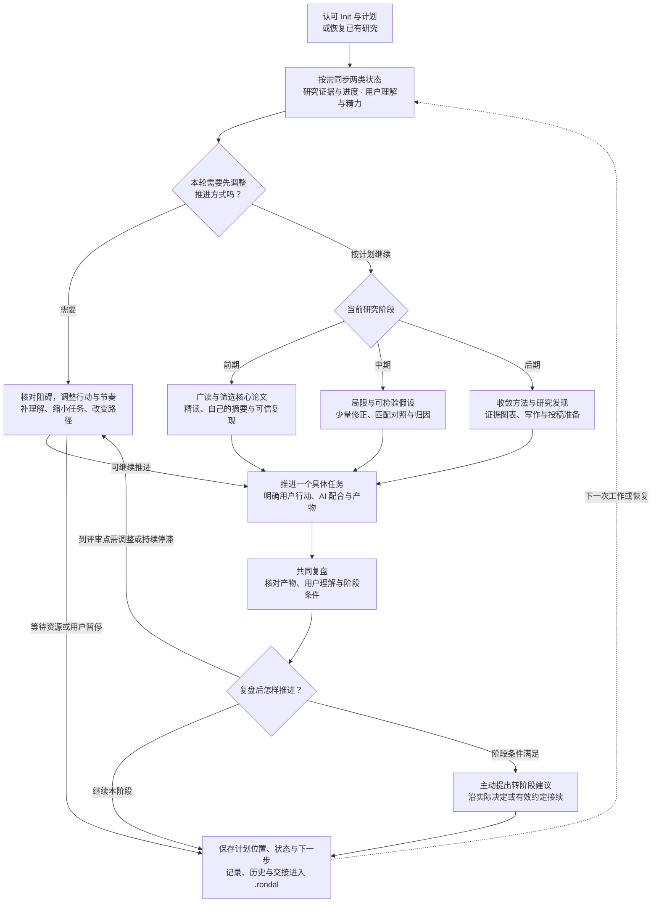

# Main 总流程图

Main 从已认可的 Init 与计划进入，或恢复已有研究。每轮先接续研究证据和用户当前状态，再选择一个具体任务，形成产物与共同复盘。图中的回路表示下一次工作或恢复，具体执行使用实际可用工具和已确定范围。

## 前、中、后期怎样转移

| 转移 | 需要具备的依据 | 条件不足时怎样推进 |
|---|---|---|
| 前期 → 中期 | 主要路线与核心选择有理由，用户能解释核心工作，约定复现已有可信证据，形成可检验问题与首项验证 | 指向一个具体理解、来源、协议或复现缺口，安排有界补充 |
| 中期 → 后期 | 核心问题已有范围明确的证据链，主要替代解释有检查，剩余关键补充是有限清单 | 优先完成有区分力的诊断或对照，结束当前假设判断，再共同收拢 |
| 后期 → 投稿准备或归档 | 主张与证据对应，全文、图表、引用、限制和复现材料可核对，正式要求与用户安排明确 | 只回补影响中心结论的缺口，说明范围和返回后期的条件 |

AI 阅读、用户自述已读、用户自己的摘要和复现证据分别记录。默认到阶段评审点，或连续两次约定的工作复盘没有实质推进时，触发调整；普通状态查询、正常等待与闲聊不累计为停滞。阶段预算触发评审，实际证据与人的选择决定如何接续。

具体职责与回传关系见 [Main 工具映射图](main-tool-map.md)。完整规则见 [Main 每轮工作](main-cycle.md)、[研究主线与阶段条件](main-research-loop.md)和[用户状态与推进](main-state-and-momentum.md)。
