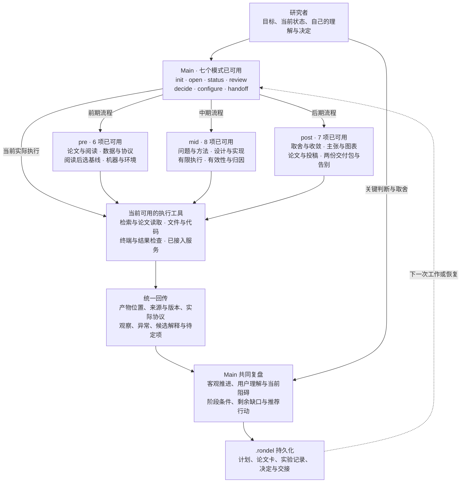

# Main 工具映射与回传图

这张图说明 Main 如何把当前研究缺口映射到工具职责，以及产物怎样回到复盘与计划。Main 七个模式、Pre 六项、Mid 八项与 Post 七项均随同一入口发布，按当前意图加载。工具职责提供流程、记录模板和核对方法，检索、改代码、远程运行及正式投稿使用当时实际可用的工具。

## 工具职责怎样映射

下表覆盖当前登记的 28 个逻辑工具。Main 根据当前问题按需选择职责，阶段表示主要关注点；例如中期可以调用论文检索职责或提前整理证据图。所有职责均由 rondel-main 调度，完整链路见 [Mid](mid-cycle.md) 与 [Post](post-cycle.md)。

| 任务或判断 | 对应工具 | 当前状态 |
|---|---|---|
| 初次相识、恢复项目 | `main.init`、`main.open` | 可用 |
| 理解当前进展与用户状态、共同复盘 | `main.status`、`main.review` | 可用 |
| 保存实际选择、修订约定与交接 | `main.decide`、`main.configure`、`main.handoff` | 可用 |
| 广读、核心论文与成熟实现、问题澄清 | `pre.library`、`pre.framing` | 可用 |
| 机器聚合、环境与数据条件核验 | `pre.environment`、`pre.data` | 可用 |
| 数据评价协议、阅读之后选基线 | `pre.protocol`、`pre.baseline` | 可用 |
| 从现象形成问题，检索相关方法与实现 | `mid.issue`、`mid.retrieve` | 可用 |
| 设计对照与落实范围内修改 | `mid.design`、`mid.implement` | 可用 |
| 执行前核对与有限范围运行 | `mid.preflight`、`mid.execute` | 可用 |
| 核验结果有效性与归因分析 | `mid.inspect`、`mid.analyze` | 可用 |
| 收敛架构或发现，整理机制 | `post.converge`、`post.mechanisms` | 可用 |
| 组织主张、局限和证据图表 | `post.claims`、`post.visualize` | 可用 |
| 论文表达与正式投稿准备 | `post.write`、`post.submission` | 可用 |
| 研究回顾、复现包、资料包与告别 | `post.closeout` | 可用 |

## Main 交出任务，保留主线判断

每次交给具体工具的内容包括当前问题、相关来源、预期产物、已确定范围和需要返回的判断依据。返回内容区分实际产物、观察、候选解释与用户尚未作出的取舍，原始证据保留可定位入口。Main 再结合用户当前理解、投入与阶段条件，推荐继续、调整或转阶段。

用户自己的摘要与理解、未完成承诺、停滞处理和阶段取舍仍由 Main 在真实交流中接续。专业工具提供核对依据，实际人的选择通过决定记录保存。完整工作循环见 [Main 流程图](main-flow.md)，能力登记以 [工具目录](shared/tool-catalog.yaml) 为准，当前可用边界见 [roadmap](roadmap.md)。
