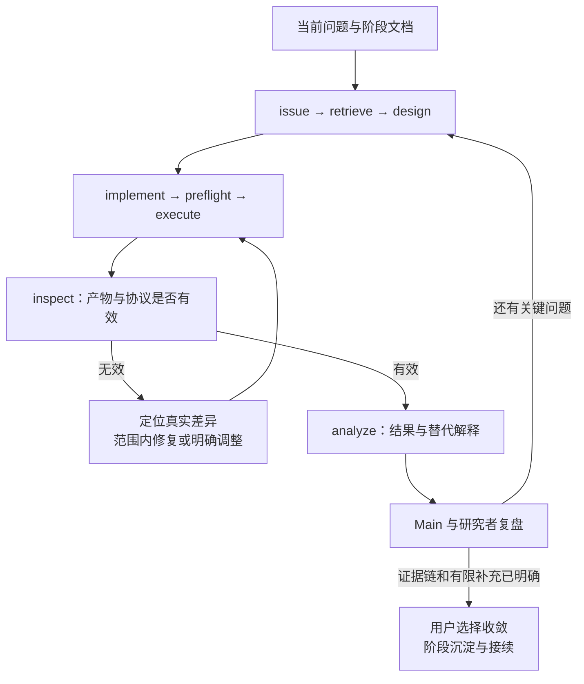

# 中期工具：围绕一个问题完成有限验证

中期接续已审阅的阶段文档、当前主问题和首项任务，以一次有结论的假设循环推进：从具体观察形成问题，定位成熟实现，设计少量对照，落实范围内修改，核对实际条件，执行有限清单，再验证产物与共同归因。阶段提供背景，用户的当前意图决定调用哪个工具，已有成熟材料可以直接从相应职责接入。每轮向 Main 返回问题、来源、产物、有效条件、候选解释、用户判断和下一步。

| 模式 | 先读 | 主要记录与完成依据 |
|---|---|---|
| mid.issue | [具体问题](mid-issue.md) | question、hypothesis 与 research_issue；现象和解释分开，有可定位条件 |
| mid.retrieve | [来源与实现](mid-retrieve.md) | method_source；来源版本、真实调用链、可沿用部分与差异 |
| mid.design | [有限对照](mid-design.md) | experiment 草案；假设、预期、否证、冻结设置与运行范围明确 |
| mid.implement | [范围内实现](mid-implement.md) | implementation_note；源码对应、最小改动、检查与已知差异 |
| mid.preflight | [执行前核对](mid-preflight.md) | preflight 与来源快照；结构、实际版本、资源和入口分别核验 |
| mid.execute | [有限执行](mid-execute.md) | run；实际任务标识、机器、配置、状态和产物入口可追溯 |
| mid.inspect | [产物有效性](mid-inspect.md) | run_inspection；完成、完整性与协议有效性分别确认 |
| mid.analyze | [分析与归因](mid-analyze.md) | experiment_analysis；收益、损伤、替代解释和下一项判断明确 |

记录和状态继续使用 [合同](shared/note-contract.md) 与 [records.py](helper.md)，数据、协议、Baseline 和环境继续使用已冻结 setting_refs。获准的具体任务在原范围内完成，不将每个机械步骤变成新问题；新方案、额外数据或预算变化按真实选择记录。源码修复与科学路径调整分别说明，失败尝试保留，重试另建 run。

研究者亲自解释关键机制、对照含义和证据取舍，Agent 负责准备来源、实现定位及重复工作。结果偏离预期时先检查实际数据流、配置、协议和预测行为，以有效证据判断当前假设；不从一次局部失败跳到整个方向结论。语言沿用条件、操作、观察和判断，完整科学边界随来源保存。

## 中期收束

当前问题已有范围明确的证据链，主要替代解释已核对，方法或负面发现可清楚表述，剩余关键补充成为有限清单时，Main 主动建议收敛。新的方法增益不是唯一可能成果，但有价值的负面结论也需要可信比较、有效范围与有用认识。证据不足时只补影响中心判断的一项；重复尝试没有增加认识时调整问题、诊断或范围。

中期退出按 [Mid 到 Post 转移目标与评审](mid-exit.md) 的六项条件进行，先进入 converge 收拢发现与版本，再判断写作条件。Main 组织 phase_review、review_type: mid_exit，保留证据、主张候选、带入项与首项后期任务。用户选择后按 [阶段上下文](phase-context.md) 沉淀并归档，重大边界按 [session 规则](session-boundaries.md) 准备接续，工具模式本身不更改项目阶段。

