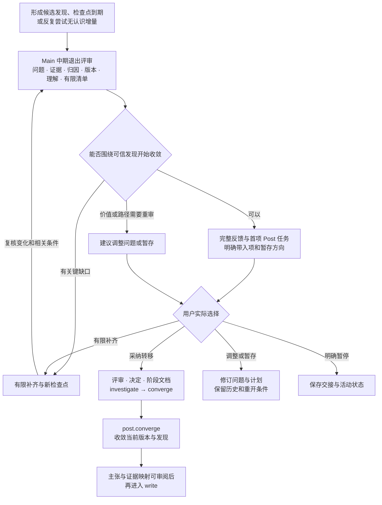

# Mid 到 Post：把探索形成的发现交给收敛与表达

正常转移的目标是：当前主问题已经形成一项有可信证据、适用条件和研究价值的候选发现，研究者能够解释它，后续工作可以围绕这项发现收敛方法、组织证据与论文。转移对应 investigate → converge，首项工作通常是 post.converge；收敛到 write 仍需另外核对贡献与证据映射。当前方法可以继续做有限补充，最终稿件、完整机制解释和全部投稿材料在相应后期职责中形成。

Main 使用现有 main.review 组织退出评审，不增加独立路由模式。条件充分时主动推荐进入 Post，约定检查点到期或反复尝试没有带来新认识时也必须复盘。阶段预算触发取舍，不能单独证明发现成立；有可信且值得保留的负面或适用性发现时，同样可以审阅其研究价值与后续表达。

## 六项正常转移条件

| 条件 | 当前必须能解释并定位的依据 | 对下一阶段的作用 |
|---|---|---|
| 主问题与候选发现已明确 | 说明针对什么问题、做了什么、观察到什么、当前认识改变了什么；关联问题、假设与分析 | Post 能围绕一项发现工作，核心表述仍可在收敛时修订 |
| 中心比较已有可信证据 | 当前方案、设置版本、实际运行、产物核验与评价相符；关键结果可回溯，收益、损伤和负面证据共同保留 | 给收敛和主张讨论一个可复核起点 |
| 归因足以支撑当前表述 | 已核对影响该表述的主要替代解释，区分观察、工程检查与机制证据；剩余未区分解释明确 | 当前认识的强度与已有对照匹配 |
| 当前候选版本可以接续 | 源码、配置、成熟来源对应、数据协议及有效条件可定位；已实现、已训练、冻结诊断和未验证部分分别说明 | post.converge 能据同一版本决定保留、删减和暂存 |
| 研究者形成了自己的理解 | 实际口述、摘要或讨论能说明中心发现、关键对照及仍未解决之处，保留其认可或异议 | 研究主线能够由研究者参与判断和表达 |
| 剩余工作能收成有限清单 | 每项关键缺口有影响、产物、负责人、投入或检查点、完成与返回条件，首项 Post 任务明确 | 后期围绕中心证据推进，新增旁支有明确去处 |

判断以当前问题与准备表达的认识为单位，不设统一增益、种子数或论文篇数门槛。若当前只有一次工程跑通、协议无法核对或关键结果无法复核，就还不足以支撑正常转移。最终展示覆盖、额外稳健性或机制补充是否阻碍进入 converge，取决于它会不会推翻目前能够成立的那一层认识，不能按实验名称机械分类。

## 阻碍、带入项与暂存方向

会动摇当前候选发现的缺口属于阻碍，例如数据泄漏或评价口径未清、核心比较混入多个无法区分的变化、关键收益无法确认、用户尚不能解释依赖的主要对照。Main 指明它阻碍哪项判断，推荐一个最小诊断或有限补充，以及新的评审点。结果仍未明时保留待定，不把范围化负结果扩大为整个方向的判决。

可以带入 Post 的工作要说明为什么不影响当前进入收敛的依据，例如已可信观察的后续覆盖、图表组织、表述整理或已定义的机制补充。每项保留真实状态、来源、预算与负责人，未验证的内容不能提前写成得到支持的主张。与中心发现关联较弱的新点子、无额外认识的同类扫描进入暂存方向，记录重开的证据条件与历史入口。

## 退出交互与四种收束

Main 先用三至五句的连贯段落说明当前怎样理解主问题、形成了什么发现、有效证据与边界是什么，以及为什么推荐此时收敛或先补一项。随后仅展示决定这次取舍的证据、阻碍和带入项，向研究者核对最影响判断的一处理解。研究者的自述、AI 的解释建议与实际路径选择分别保存，近期精力影响首项任务大小。

接着给出首项 Post 任务的具体安排：收拢哪个版本或发现，比较哪些保留理由，研究者需要解释什么，AI 整理什么，留下哪份产物和何时复盘。Main 提出一个主要选择，已有明确采纳或适用的条件性决定时直接接续。阶段变化不把尚未选择的实验或外部动作加入执行范围。

| 评审结果 | 保存的判断与安排 | 阶段接续 |
|---|---|---|
| 进入 Post | 条件充分，推荐当前收敛对象、带入清单与首项任务 | 用户选择后 investigate → converge，先调用 post.converge |
| 有限补齐 | 命名阻碍中心判断的缺口、最小补充与检查点 | 保留 investigate，完成后只复核变化和相关条件 |
| 调整或暂存 | 发现价值或可行性不足、反复无认识增量，给出收缩问题或暂存建议 | 沿实际选择修订问题与计划，必要时只重开受影响的 Pre 条件 |
| 暂停 | 用户明确选择暂停，保存当前证据与未完任务 | 保留阶段并按实际选择更新 activity，在跑任务单独处理 |

检查点到期且条件充分时，Main 推荐收敛并把外围探索带入或暂存，避免原样延长中期。同一阻碍再次出现时，改变诊断、比较对象、问题范围或投入安排，说明这次为何更有区分力。用户仍可选择提前进入 Post，此时保存未解决条件、理由与可先做的有限任务，评审不能把缺口记成通过。

## 持久化与下一轮加载

按 [退出评审模板](../assets/templates/mid-exit-review.md) 建立 discussion，purpose: phase_review、review_type: mid_exit，关联问题、当前版本、有效分析与设置。保存六项条件、证据、推荐结果、阻碍、带入项、研究者自己的解释及首项 Post 任务。真实选择另存 decision，再通过 configure 更新 phase、当前计划与 next_step，review_ref 和 plan_ref 定位本次评审及新计划。

依 [阶段上下文](phase-context.md) 形成 summary_of: investigate、summary_for: converge 的 phase_summary，短 brief 留下主问题、候选发现及条件、实际决定、设置版本、未解项与下一步，原证据保留导航。相关运行、当前方法与带入项仍可检索，旧方向和临时推演退出默认加载。重大阶段边界按 [session 规则](session-boundaries.md) 先准备接续包再建议新会话，用户未选择时继续当前会话。

以上判断来自实际材料与共同审阅，现有脚本只校验记录、引用、版本和状态来源。main.review 负责科学与交互评审，路由只定位相应指引和任务上下文。仅编写规则或准备评审草案不会变更真实研究项目。

