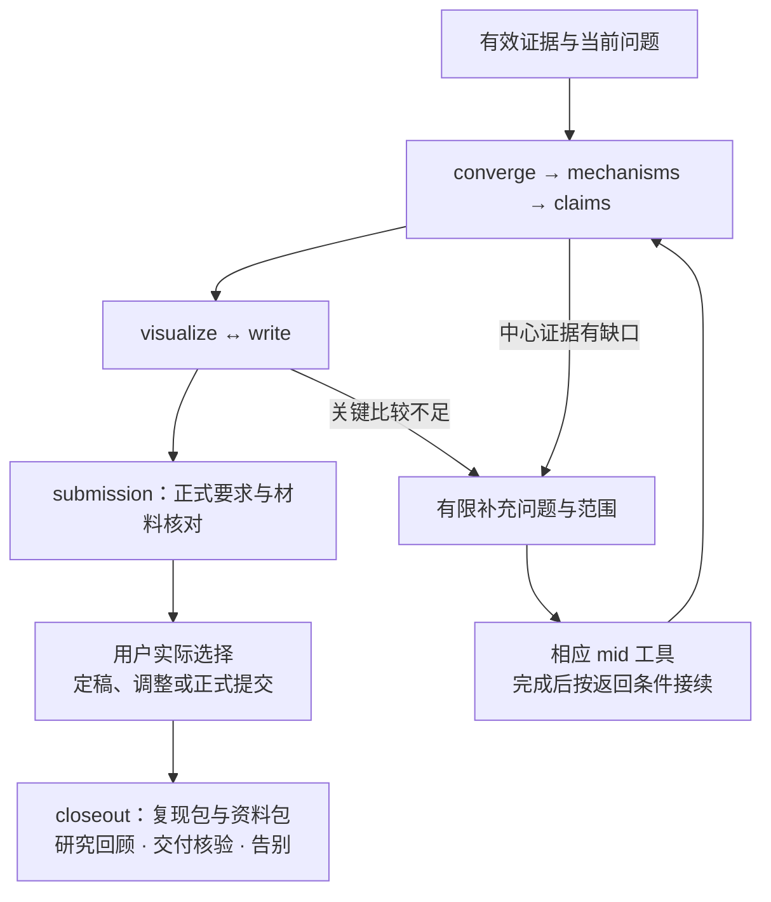

# 后期工具：收敛认识、组织证据并完成表达

后期围绕当前问题与已核验的证据收拢方法或发现，说明机制、形成主张，组织图表和论文，再核对正式投稿材料。可以从已经成熟的材料接入，也可以在中期提前调用某项写作或视觉职责。阶段是当前关注点，工具按真实请求选择，不强制把已有研究重新走一遍。

| 模式 | 先读 | 主要产物与完成依据 |
|---|---|---|
| post.converge | [收敛](post-converge.md) | convergence；当前版本、保留理由、有限补充与停止扩张的依据 |
| post.mechanisms | [机制沉淀](post-mechanisms.md) | mechanism；功能、数据流、条件、证据类型与尚未解释之处 |
| post.claims | [主张与局限](post-claims.md) | claim 与 claim_evidence；原话、证据、适用条件和实际采用分别可追溯 |
| post.visualize | [图表](post-visualize.md) | figure_plan；结论、真实源数据、处理、统计口径和可编辑产物 |
| post.write | [论文表达](post-write.md) | manuscript；问题到贡献的连贯论证与可核对的引用和结果 |
| post.submission | [投稿准备](post-submission.md) | submission_requirements/package；正式要求、时间时区、材料版本与核对依据 |
| post.closeout | [研究收尾](post-closeout.md) | 复现包、资料包、实际验证范围、研究回顾与自然告别 |

通用记录沿 [合同](shared/note-contract.md) 和 [records.py](helper.md)，文稿与图表保留实际来源，表达沿 [沟通规范](shared/communication.md)。旧结果引用原条件，设置修订后的比较分别处理。需要补实验时只命名影响中心主张的缺口、补充范围与返回后期的条件，避免每个新点子都重启全部研究。

实验期积累的关键数据与候选 claim 通过 [统一笔记取舍](paper-material-selection.md) 进入论文组织，主文、补充与研究档案分别保留理由。收尾也可以针对可信负结果或提前结束的项目，不以投稿或发表为必要前提。两份包的交付、真实复现和项目归档分别记录。

## 后期内部转移与交接

从 Mid 接入按 [转移目标与退出评审](mid-exit.md) 核对，入口是围绕可信候选发现开始 converge。读取中期阶段文档、当前版本、带入清单和首项任务，再形成后期自己的收敛产物。最终架构和正式主张在相应职责中审阅，不能因阶段已改变便假定证据缺口已消失。

converge 到 write 需要当前方法或发现已形成明确版本，中心问题、贡献与证据映射可审阅，关键缺口有有限处理清单。write 到 submit 需要稿件、图表、引用、方法边界和复现材料可核对，实际目标与正式要求已查证。提交、接受或发表只按真实回执记录，不由本地打包完成推断。

Main 在相应检查点组织 phase_review，review_type 可以用 post_convergence 或 submission_readiness，保存当前版本、证据缺口、用户理解和实际选择。阶段更新沿用户当前或仍适用的条件性决定；具体投稿或外部发布范围另外确定。按 [阶段文档](phase-context.md) 和 [session 边界](session-boundaries.md) 准备后续入口，原始材料继续保留。

