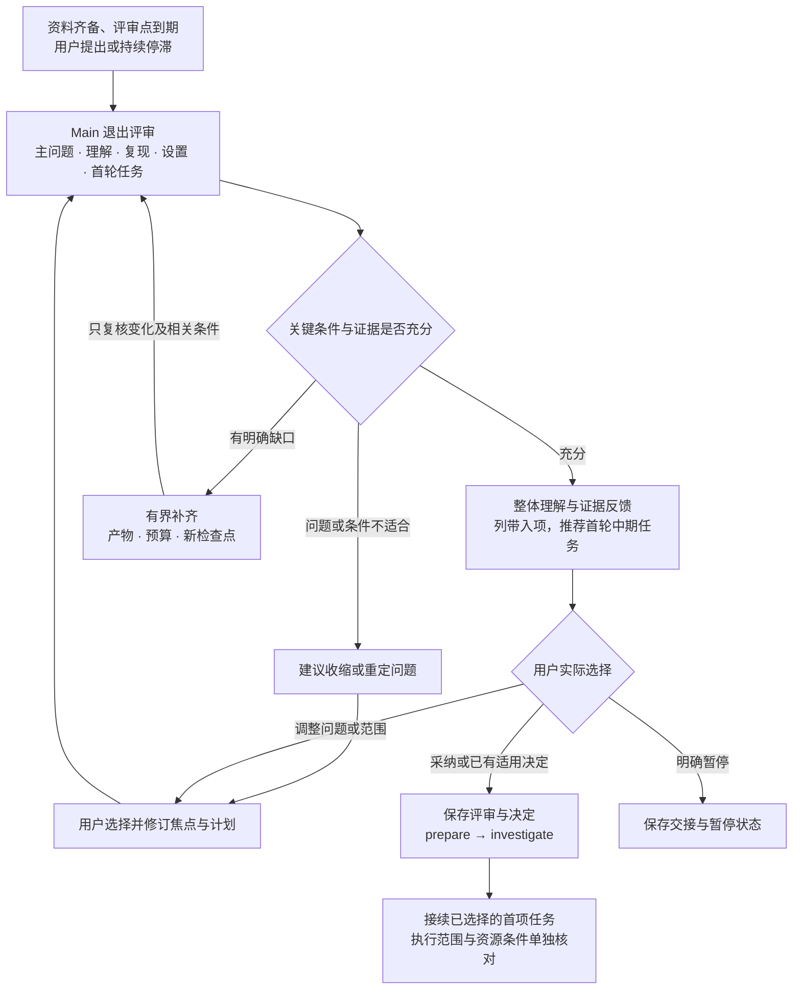

# Pre 退出：从可信准备进入第一轮研究验证

Pre 的正常退出目标是：研究者已经形成有依据的问题、理解关键工作、拥有可信且条件明确的比较起点，能够选择第一轮可归因验证。Main 需要给出完整判断、关键证据、剩余缺口和明确的下一步，再沿用户实际选择接续。退出评审使用现有 main.review，阶段变化使用现有决定与配置流程，不增加新的独立工具。

## 什么时候发起评审

常规准备任务已完成时，Main 主动发起退出评审。阶段预算或约定检查点到期、用户主动提出转阶段、连续两次约定复盘缺少实质推进时，也发起评审，重点判断补齐、收缩、调整路径或暂停。条件具备后应推荐前进；新论文进入外围集合，不自动重启整个 Pre。

`preparation.py status` 的 pre_review_tasks_complete 只统计 phase_review 以外的九项任务及结构问题，避免等复盘完成后才允许复盘。checklist_complete 继续包括阶段复盘，表示整个已记录清单的结构检查。二者只提供导航，Main 可以在清单未齐时召开评审，并据实际材料判断缺口是否阻碍下一步。

## 正常退出的六项条件

| 条件 | 必须能说清楚并定位的依据 | 仍未满足时怎样处理 |
|---|---|---|
| 领域与主问题已经收拢 | 可检索领域摘要、少量有来源的核心痛点、用户选择的主问题；说明对象、条件、希望改变的行为与重要性 | 将模糊方向缩成一个问题，补最能改变取舍的来源或观察 |
| 阅读已形成取舍 | 主要路线覆盖与核心集合有选择理由；约定核心精读已经完成，用户能用自己的话解释任务、机制和关键对照 | 回到相关原文、方法图或调用链，形成一段用户自己的解释 |
| 有可信 Baseline 与复现 | 来源实现、版本、配置和实际协议可核对；约定首批核心复现达到约定范围，至少有一条可信比较起点，偏差已有判断 | 定位最影响可比性的差异，补有界复现或改选有理由的对象 |
| 关键设置与证据一致 | 本轮数据、协议、Baseline 和环境定义已核验并冻结；复现引用实际版本，影响关键比较的变更已处理 | 复核受影响条件，按来源明确保留、重算或移出比较 |
| 有值得检验的具体缺口 | 局限或现象有原文、复现或实际观察来源；已区分作者结论、观察与猜想，问题能够被证据支持或削弱 | 补一项诊断、条件比较或原文核对，再决定是否保留这个问题 |
| 第一轮中期任务可以落地 | 一个具体假设或判别问题、最小对照、允许变化、固定条件、预期观察、否证或待定解释、预算、分工和复盘点明确 | 先形成可审阅的有限方案，缩小并行变化和当前工作量 |

领域阅读依据覆盖和取舍判断，不以读完所有论文或固定篇数判定。复现的完成范围在前期计划中确定，可以有代表性对象和有限条件，但工程导入、一次前向或损失下降各自只说明对应检查。新的方法增益、最终贡献包装和成熟论文故事线属于后续研究产物，不作为正常退出 Pre 的必要条件。

研究者的理解通过实际口述、自己的摘要或具体质疑体现，Main 只围绕当前决策依赖的关键点讨论。暂时缺少信心、精力低或并行事务多用于调整首轮粒度，不独立判定科学条件失败。当前尚不能解释核心设定或对照作用时，先完成一项针对性的共同阅读，AI 的摘要不替代这份理解来源。

## 剩余项：阻碍条件与可带入中期的任务

影响当前主问题、比较有效性、用户关键理解或第一轮判别能力的缺口属于阻碍条件。例如划分边界仍未明确、基线版本与结果不符、复现只有工程检查、局限没有来源、关键设置变更尚未处理。每个阻碍明确对应哪项判断、补什么产物、预计投入和下一检查点，不能笼统写“继续阅读、继续完善”。

外围论文、非首轮必要的数据集、补充可视化和当前判断不依赖的旁支可以带入中期。主实验机暂时无空闲资源时，已有可信复现、固定设置和首轮方案仍可审阅，先安排分析或方案讨论；真实执行等资源和实际检查到位后再开始。若环境尚未建立或数据不可得，已阻断首条可信复现或核心比较，则仍是准备缺口。

带入项保存原因、对当前判断的影响、负责人、后续任务引用、触发时间或复盘点。Todo 保留真实的 todo、blocked 或 needs_review，有期限的后续任务不改写成 done 或 waived；waived 只用于用户明确选择的不适用项。范围收缩也需要指出新范围及排除的比较，原设置、运行和历史判断仍保留。

## 退出交互：完整理解、证据摘要、一个主要选择

Main 先用一个三至五句的完整段落说明：目前怎样理解这个领域与主问题，前期形成了什么认识，哪些条件已经满足，为什么推荐进入中期或补哪一项。随后只展示决定这次取舍所需的证据与阻碍，资料很多时用紧凑表格，来源进入链接。用户状态影响本轮行动大小，科学条件依据原始材料判断。

接着展示第一轮中期任务：用户需要亲自判断什么，AI 承担哪些准备或重复工作，期望留下什么产物，何时共同复盘。最后聚焦一个主要选择，例如“我建议以这个问题进入中期，第一步先审阅这项对照；你希望按此推进，还是先调整问题或范围？”实际任务已经被用户明确选择时直接接续，不再重复确认同一决定。

退出评审可以收束为下面四种结果，Main 应先给出推荐和理由。它们是评审结论，项目仍沿现有 phase 与 activity 保存状态。用户选择改变安排时更新计划和证据引用，不自动生成运行队列。

| 结果 | 交互收束 | 状态与下一步 |
|---|---|---|
| 进入中期 | 条件已满足，说明带入项并推荐首轮验证 | 用户采纳后 prepare → investigate，关联当前评审、决定和首项任务 |
| 有界补齐 | 明确目前阻碍哪项判断，只补最关键的一项或有限清单 | 保留 prepare，记录产物、预算与新评审点，完成后只复核变化与相关条件 |
| 收缩或重定问题 | 现有设定不适合当前资源、价值依据不足或路径反复无增量 | 保留历史并沿用户选择修订焦点和计划，只重开受影响准备项 |
| 暂停 | 用户明确要求暂停 | 保存交接并记录 paused，在跑任务按实际指令处理 |

若用户认为还需要继续阅读，Main 请其指出新增材料会改变哪项判断，形成有边界的阅读目标。若条件已经充分且没有这类缺口，就推荐把外围材料带入中期，先完成一个小验证。相同阻碍再次出现时，下一次评审改变资源、对象、问题范围或投入安排，沿实际选择推进，不能原样延长整阶段。

用户也可以明确选择提前进入中期，或修订原先约定的准备范围。此时记录为带未解决条件的提前转阶段，保留真实缺口、理由、可先开展的有限任务和执行前仍需补足的条件，不把缺失证据记成满足。用户只说“记录下来”时保存评审或建议稿，尚未形成阶段选择的内容仍作为建议。

## 保存与接续

实际阶段选择同时触发 [阶段上下文沉淀](phase-context.md) 的准备：保留下一阶段需要的信息与来源，把不再需要默认展开的推演和旧方向登记到归档导航，形成可审阅的阶段文档。沿已表达的采纳范围发布摘要，再接续实际阶段与计划，避免下一阶段重放全部历史。当前只设计规则或用户明确暂不转阶段时，不操作真实研究项目。

退出评审使用 `purpose: phase_review`、`review_type: pre_exit` 的 discussion，按 [评审模板](../assets/templates/pre-exit-review.md) 保存六项条件、证据、阻碍、带入项、推荐结果和首轮任务。phase_review Todo 关联实际评审记录；评审已经进行与条件是否满足分别记录，不能用一条完成状态替代结论。评审中的数据、协议与设置引用保留对应冻结版本。

用户采纳后保存真实 decision，再用 configure 更新 phase、当前计划和 next_step，令 next_step.review_ref 指向本次评审、plan_ref 指向更新后的计划。保留当前主问题、用户自己的理解、未完成承诺和带入任务，下一轮直接定位首项工作。若一条仍适用的用户决定明确约定了转阶段条件，核对实际条件后沿原来源接续；目标或范围已变时重新讨论。

阶段转换与实验执行范围分别记录。进入 investigate 可以先讨论方案或分析材料，训练、数据访问和远程动作仍沿具体方案与实际范围执行。核心设置或问题变更影响准备依据时，重开受影响的 Todo 并记录返回条件，Main 持续把关而不重做全部 Init。

