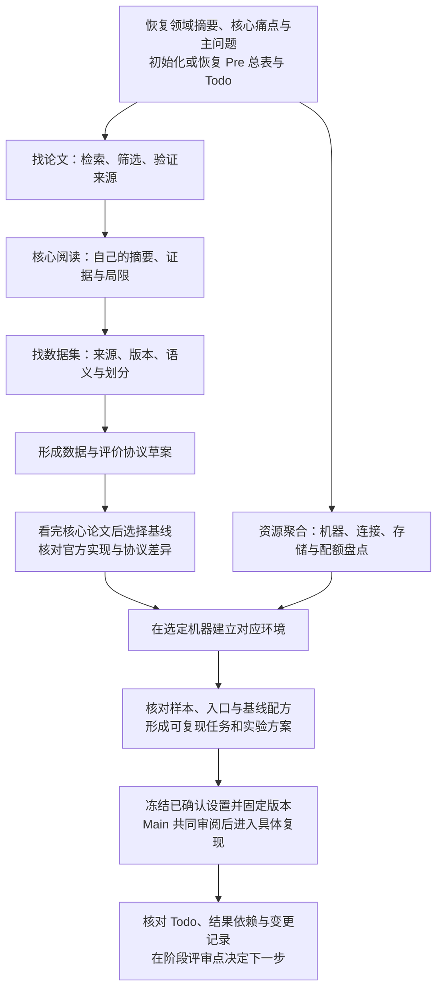

# 前期职责：从阅读走到可信基线

正式进入前期先读 [初始化与跟踪](pre-tracking.md)，初始化或恢复准备总表，并按 [辅助脚本](preparation-helper.md) 接入 Todo、冻结设置与 Changelog。当前领域摘要、少量核心痛点与主问题显式维护；每次恢复核对本轮相关的剩余项与版本。用户只请求一个独立任务时沿既有材料完成该项，完整 Pre 的跟踪在需要接续和保存时建立。

前期按检索锚点、论文检索与阅读、数据集与数据评价协议、基线选择、目标机器环境、复现准备推进。机器资源盘点可以提前并行，真正建立依赖环境放在核心论文和基线仓库选定之后。正式基线选择以已读懂的核心工作为依据，代码浏览在阅读阶段用于理解实现，不能把候选仓库自动当作选定基线。

这些流程随 rondel-main 按需加载，使用现有检索、文件、连接与执行工具完成，没有独立训练后台。每步交付简短判断、来源、产物、当前缺口和下一项行动，记录进入工作区 `.rondel/`。用户笔记软件通过 [笔记适配](note-adapters.md) 接入，原始数据、环境与运行产物保留在绑定的机器和位置。

用户只请求一项准备工作时，只补足该任务真正需要的输入，已有问题与来源直接采用。未建档时可以先在对话中完成核对并给出待保存稿，准备落盘时再接入工作区，无需重做整轮 Init。用户明确指定的操作范围与已有授权在适用范围内沿用。

| 逻辑工具 | 先读流程 | 产物与完成依据 |
|---|---|---|
| `pre.framing` | [问题起点](pre-framing.md) | 检索锚点、任务边界、开放问题及用户来源 |
| `pre.library` | [找论文与阅读](pre-papers.md) | 检索日志、领域地图、核心论文卡和用户自己的理解 |
| `pre.data` | [找数据集](pre-datasets.md) | 数据卡、版本与样本语义、划分入口及访问条件 |
| `pre.protocol` | [数据与评价协议](pre-protocol.md) | 可核对的协议版本、基线特定配方入口与待定项 |
| `pre.baseline` | [阅读之后选基线](pre-baselines.md) | 核心阅读依据、候选对照、选定来源及差异 |
| `pre.environment` | [环境流程](pre-environment.md)和[资源聚合](resource-aggregation.md) | 目标机器、位置映射、依赖与环境验收记录 |

前期各步骤可以带着明确缺口往返。数据或环境未核验时如实保留状态，不以文件存在或能导入框架代替完整准备。进入复现前将实验假设、范围、数据与协议、代码版本、机器及产物位置写入 [实验方案模板](../assets/templates/experiment.md)，后续结果使用独立的 [分析模板](../assets/templates/experiment-analysis.md)。

数据、协议、Baseline 与环境按各自用途初始化设置，核验后沿实际选择冻结；修改已冻结定义时建立关联版本并审阅历史结果影响。Main 持续核对当前工作与主问题、设置版本和证据之间的关系，原始结果保留各自条件。前期完成依据来自 Todo 与共同审阅，具体规则见 [前期跟踪](pre-tracking.md)。

阶段收束按 [退出条件与交互](pre-exit.md) 进行，区分可发起评审、正常退出和有界补齐。先用完整段落反馈理解与判断，再推荐首轮中期任务或一个关键补充，保留带入项和下一检查点。正式进入、调整问题、补齐或暂停沿用户选择保存，已有适用决定直接接续。
