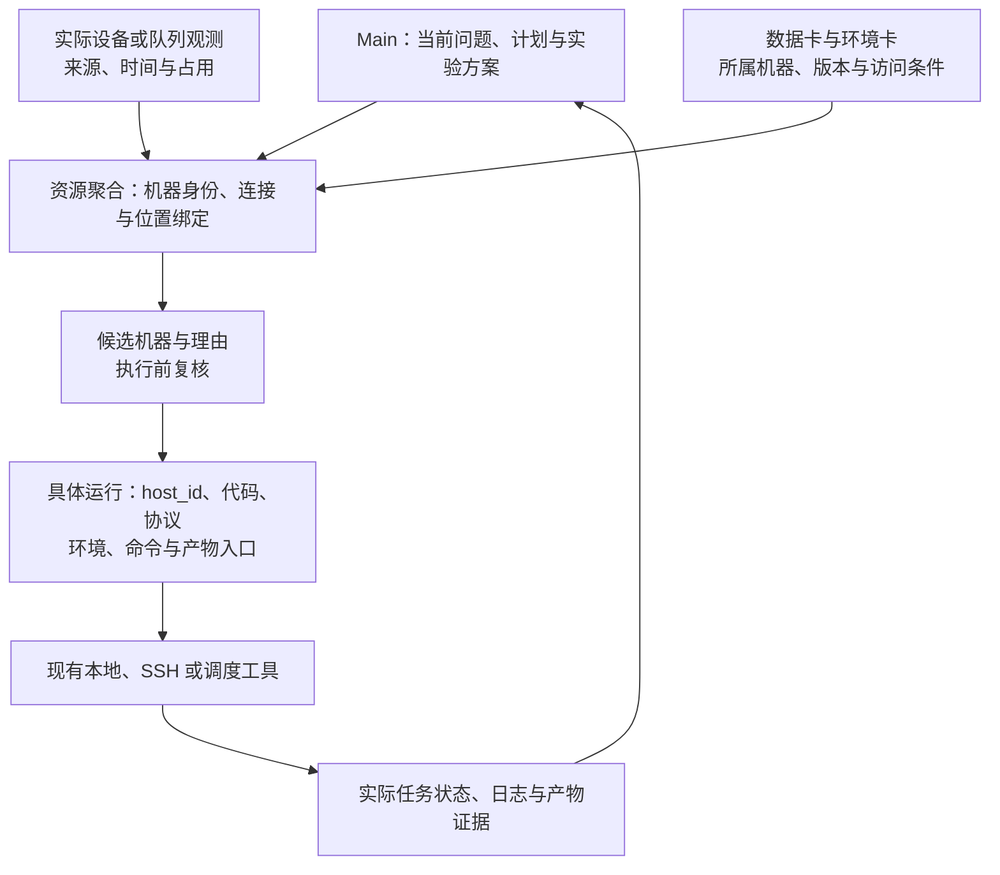

# 实验资源聚合层

资源层把不同机器、连接、代码、数据、环境、运行与产物入口汇总为 Main 可定位的资源目录。Agent 所在机器只是一种入口，实验目标必须绑定明确的 `host_id`。本地 `.rondal/` 保存卡片、引用、观测时间与调度建议，代码、数据、环境和大型产物保留在各自机器的约定位置。

## 机器与位置

每台机器用 `resource`、`purpose: machine` 记录稳定的 host_id、用途、操作系统、连接类型与现有连接别名。连接可对应本地、SSH 或用户现有调度系统，认证材料留在既有认证机制中。硬件能力、设备与存储、允许用途、实际可用量分别记录，配置上限和当前空闲量不能混用。

位置绑定同时包含机器与该系统上的路径字符串，例如代码、数据、特征、环境、检查点与产物路径。远程 Linux 路径、远程 Windows 路径和本地路径是不同命名空间，用户未确认共享存储或同步关系时不能相互替代。数据卡与环境卡关联同一 host_id 或明确的跨机器访问方式。

## 观测、占用与选择

机器状态记录观测来源、时间、有效期或需要复核的条件，区分未知、可用、忙碌、不可达和待核对。当前占用以实际队列、设备观测和用户范围为依据，登记过机器不代表已获得资源预留。陈旧或未知状态在执行前复核，连接失败时保留原因，不能静默切回本机运行。

聚合层先按数据与环境所在位置、设备与内存需求、软件与系统兼容性、时间和配额筛选候选，再给出为什么推荐某台机器。用户指定目标或已有明确安排时沿用，迁移与并行范围变化保留实际选择。当前 [资源辅助脚本](resource-helper.md) 提供本地登记的汇总与候选筛选，不执行 SSH、探测设备或预留 GPU；实际观测通过当次可用连接工具取得。

## 实验怎样接入

每个具体运行关联机器、连接或调度入口、代码版本、数据和协议引用、环境、命令或任务标识、产物位置与观测来源。提交、排队、运行、退出与结果核验分开记录，Main 可以汇总跨机器状态并定位异常。不同机器的结果汇总前核对数据与特征版本、数值条件和实际协议，运行完成后回收的是报告与必要证据入口，大产物按既有位置保管。

使用 [机器资源模板](../assets/templates/machine.md)与 [运行模板](../assets/templates/run.md)。已有连接工具或调度器承担真实执行，Rondel 的层负责绑定、聚合、核对与协调，避免同时维护另一套未经核验的任务状态。资源等待写入当前任务与计划，在实际条件满足后接续，用户状态与科学假设评估分别保留。
