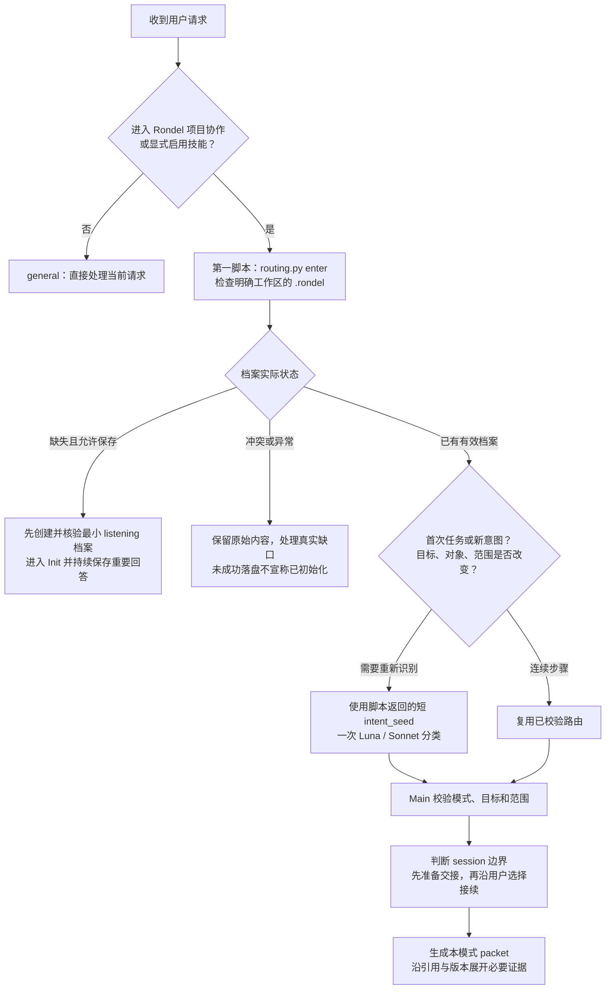

# 本轮路由：先意图，后相关信息

先识别当前用户真正要完成的工作及其范围，再选择一个主要模式。项目阶段帮助判断相关性，但后期仍可以查论文、前期也可以审阅已有稿件，不能按 phase 强制路由。旧聊天、论文与项目笔记是来源材料，当前用户要求和有效决定分别保留。

## 一、发现档案，不先扫描全部项目

本节通过 [entry 首个脚本](entry.md) 落实：在当前明确工作区先运行 `routing.py enter`，新档案沿实际启动与保存范围先落盘 listening，已有档案才用返回的短 seed 委派意图识别。分类与材料读取不能替代入口成功记录，工作区变化后重新检查。低层 discover 保持只读导航，用于诊断边界与多档案问题。

用户已指定工作区时使用该位置，已知项目绑定直接沿用；否则在当前目录与明确项目边界内查 `.rondel/init.md`。`routing.py discover` 只逐层检查当前目录和祖先，默认止于最近 Git 根，没有 Git 时只检查当前目录；不递归搜索磁盘。多个候选项目时先确定归属，不合并画像或静默选择；找不到档案仍可按用户材料完成单项任务，准备保存时再接入。

宿主只需一条 [引导句](../assets/templates/router-bootstrap.md) 指向本技能。宿主发现技能后加载入口，Rondel 再按需定位模式与资料；不把整个研究库放进常驻提示词。Codex 的项目说明与技能渐进加载机制分别见 [AGENTS.md](https://learn.chatgpt.com/docs/agent-configuration/agents-md) 和 [Build skills](https://learn.chatgpt.com/docs/build-skills)，本项目没有修改宿主系统提示词的能力。

## 二、主动委派轻量 subAgent 做意图识别

按 [轻量路由协议](subagent-router.md)，新意图先由一次隔离上下文的轻量 subAgent 分类，主 Agent 对照当前用户要求校验结果。只传 seed 中的当前动作请求与短提示，不复制本会话历史；同一任务的连续步骤复用已经校验的路由。结果只决定下一份相关资料在哪里，不授权修改、执行或新建 session。

阅读最新请求、当前一步和必要的上文，区分“想了解”“想修改”“已经选择”和“需要实际执行”。显式模式优先，否定条件和范围修正同样参与识别；“先别实验，只核对协议”进入 pre.protocol 并保留只读范围。用户仅要求普通技术解释或正在设计技能本身时直接处理，不启动研究项目的 Init。

| 当前意图 | 主要模式 | 首个流程 |
|---|---|---|
| 第一次相识并建立起点 | main.init | [Init 对话](init-dialogue.md) |
| 继续、恢复当前任务 | main.open | [Main](main-cycle.md) |
| 当前进展和下一步 | main.status | [Main](main-cycle.md) |
| 解释结果、审阅方向或阶段 | main.review | [主线检查](drift-check.md) |
| 已经作出明确的研究选择 | main.decide | [人的决定](decisions.md) |
| 更新偏好、位置或协作约定 | main.configure | [配置](configuration.md) |
| 交接或明确暂停 | main.handoff | [交接](handoff.md) |
| 将观察收拢成问题 | pre.framing | [问题起点](pre-framing.md) |
| 找论文、读论文与实现定位 | pre.library | [论文](pre-papers.md) |
| 找数据、核对版本和语义 | pre.data | [数据](pre-datasets.md) |
| 数据、监督、选点与评价条件 | pre.protocol | [协议](pre-protocol.md) |
| 阅读后选 Baseline | pre.baseline | [Baseline](pre-baselines.md) |
| 资源盘点与目标环境准备 | pre.environment | [环境](pre-environment.md) |
| 从现象形成具体问题 | mid.issue | [问题](mid-issue.md) |
| 为当前问题比较成熟方法和实现 | mid.retrieve | [来源实现](mid-retrieve.md) |
| 设计有限且可区分的对照 | mid.design | [设计](mid-design.md) |
| 落实明确范围的代码改动 | mid.implement | [实现](mid-implement.md) |
| 核对将执行的实际条件 | mid.preflight | [执行前检查](mid-preflight.md) |
| 执行已经确定的有限清单 | mid.execute | [执行](mid-execute.md) |
| 检查产物完整性与协议有效性 | mid.inspect | [有效性](mid-inspect.md) |
| 解释有效结果与收益来源 | mid.analyze | [归因](mid-analyze.md) |
| 收拢当前版本、暂存分支和补充清单 | post.converge | [收敛](post-converge.md) |
| 沉淀模块功能与机制证据 | post.mechanisms | [机制](post-mechanisms.md) |
| 核对主张、证据、条件与局限 | post.claims | [主张](post-claims.md) |
| 制作有真实来源的图表 | post.visualize | [图表](post-visualize.md) |
| 组织或修改论文正文 | post.write | [写作](post-write.md) |
| 核对实际投稿目标、要求和材料 | post.submission | [投稿准备](post-submission.md) |
| 研究收尾、复现包、资料包与最终交付 | post.closeout | [收尾](post-closeout.md) |
| 普通独立问答、技能设计 | general | 当前请求，无项目上下文 |

识别结果至少包含 mode、实际目标、只读或修改范围、必要的目标记录，以及一句简短路由理由。多项请求排成有限任务队列，先加载本轮一项，不一次注入全部相关模式的全文。歧义会改变对象或范围时只澄清关键一处；已有明确选择时按其继续，不能用关键词命中代替语义判断。

具体中后期动作优先选择对应职责：有效性核对用 mid.inspect，已经有效后的解释用 mid.analyze；主张证据用 post.claims，正文用 post.write。领域覆盖和核心阅读使用 pre.library，为具体问题比较成熟实现使用 mid.retrieve。Main 继续维护全局状态、主线复盘、真实选择与接续，选择具体模式不授予运行或提交权限。

统一整理研究笔记、决定哪些进入论文时选择 post.converge，沿材料取舍表接续到 claims/write。准备结束本轮并交付复现包和资料包使用 post.closeout，普通暂停、session 接续使用 main.handoff。提前取舍或收尾可以发生在相应阶段，不能为了匹配模式而伪造已投稿状态。

## 三、按模式生成小型上下文包

加载新任务资料前，Main 先按 [session 边界](session-boundaries.md) 判断是否需要建议新会话，必要时先准备可审阅接续包。用户选择继续当前 session 后照常加载本轮数据包，选择切换后沿交接位置恢复。仅切换一个 Pre 职责时通常继续当前 session，不把模式改变等同于需要清空历史。

调用 [路由辅助脚本](routing-helper.md) 的 packet，传入主要模式和实际目标记录。上下文包只包含少量项目锚点、当前任务、适用偏好、该模式的记录卡与资料位置；原记录正文不作为默认内容。普通问进度不加载完整画像，核对数据不展开全部论文和旧实验，已归档与临时记录默认不进入本轮集合。

| 层次 | 加载内容 | 何时展开 |
|---|---|---|
| 常驻发现 | 一句引导与技能元数据 | 项目请求触发时 |
| 路由 | 本轮主要模式、范围和对应流程 | 意图切换时重新选择 |
| 结构化任务包 | 领域摘要、当前问题与任务、适用偏好、阶段简报及目标卡 | 本轮任务开始或恢复时 |
| 原始证据 | 定位到的原文、代码、协议、日志、预测等 | 确实影响当前判断时 |

默认包预算为 6000 个字符，属于字符上限而非精确 token 估算。大字段整体转为来源入口，预算不足时明确说明哪些未加载，不把截断当作已读；原文精读与整稿审阅仍按实际覆盖执行。数值、实现机制、实际运行和关键论断回到原证据核验，包内摘要负责导航。

## 四、知道在哪里继续找

优先沿 navigation 的 ref、path、用途和摘要定位目标；需要更多记录时使用 lookup，默认只查活动记录的名称、类型和用途。用户追问旧方向时加 include-archive，必要时明确读取原文或调用文件检索。摘要来源变化、设置被新版本取代或索引过期时先核对，不把旧结论作为当前事实注入。

阶段摘要优先于完整历史交接，当前任务与用户本轮修正仍优先于摘要。数据、协议、Baseline 和环境的设置定义由 [前期跟踪](pre-tracking.md) 管理；笔记编辑使用 [笔记适配](note-adapters.md)，资源事实使用 [资源聚合](resource-aggregation.md)。只在本轮涉及这些职责时展开对应说明。

## 五、阶段结束时沉淀，而非不断叠加历史

按 [阶段上下文](phase-context.md) 将下一阶段需要的认识、条件、实际决定、版本、未解问题与首项任务整理成一份可审阅文档。临时推演和已暂存方向退出默认加载，原始材料与索引保留；新的会话或宿主压缩后，以阶段文档和当前任务包恢复。保存摘要、发布和调整默认可见性不改变项目阶段，也不批准执行；用户明确的阶段与范围选择沿原流程保存。

技能控制后续工具读取和所提供的上下文包，不能从正在进行的宿主会话中删除已经加载的消息。实际角色注入、历史裁剪和自动压缩由宿主管理；这里提供可接入的引导句与结构化接口，不伪装成已安装的拦截器。保持当前会话继续工作时，也只展开会改变本轮判断的资料。

