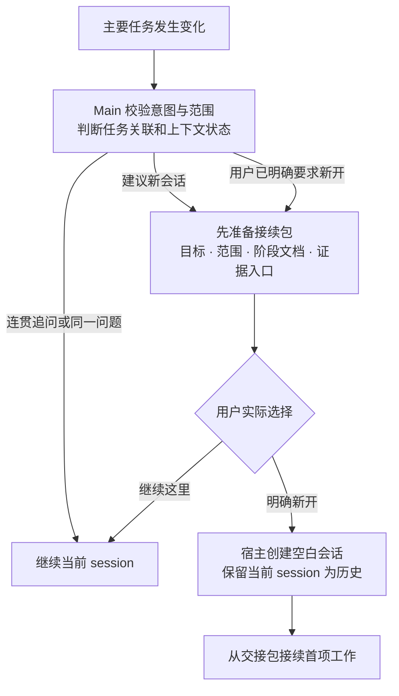

# 任务转换时主动建议 session 边界

在主要意图校验后、加载大量新资料前，Main 判断当前工作适合继续本 session，还是应建议新开一个。模式变化本身不是切换理由，同一研究问题从论文走到数据、协议和环境通常可以顺畅接续。判断依据是任务关联性、旧上下文是否仍有帮助、预期读取量与当前上下文是否已经干扰工作。

## 什么时候提出建议

| 当前变化 | 默认处理 | Main 说明的理由 |
|---|---|---|
| 同一问题的追问、小修正或已确认队列项 | 留在当前 session | 既有上下文仍直接服务任务 |
| 同一研究内切换 Pre 职责 | 通常继续 | 角色不同但问题、设置与证据连续 |
| 正式进入新阶段，阶段文档已就绪 | 主动建议新 session | 下一阶段可从稳定文档与首项任务开始 |
| 新项目、独立主问题或不同目标 | 主动建议分开 | 原任务可以保留，避免混用画像、范围或结果 |
| 大量调试/日志之后转入集中写作，或用户指出旧内容正在干扰 | 主动建议新 session | 新任务只需要审阅后的认识与必要证据入口 |
| 用户明确要求新开 session | 准备交接后按其要求落实 | 不重复询问同一选择 |

上下文长度只有宿主明确提供时才引用具体数值，不能编造 token 占用或剩余额度。用户当前精力、任务大小与希望连贯交流的偏好影响建议方式。一次任务边界只提出一次主要建议，用户选择继续后沿其安排工作；有新的关键变化再重新评估。

## 建议前先准备可携带内容

使用 [session 交接模板](../assets/templates/session-bridge.md)，先整理目标、项目与阶段入口、当前问题、真实决定、有效范围、必要设置及证据引用、未完成项和新 session 首项任务。通常可以引用已审阅 phase_summary，不复制旧对话或整套材料。交接包是可审阅的具体产物，主 Agent 准备好后再提出切换建议。

例如：“这次要从实验核对转到完整论证，新的工作主要需要当前证据与主张，旧日志细节已经不再直接服务它。我已经整理好阶段摘要、范围和稿件入口，建议新开一个 session 从这份交接开始。你希望切换，还是继续在这里？”用户继续当前 session 时，保留原任务与精简上下文，不反复催促切换。

## 实际创建与接续

建议、询问是否有必要，或编写这项规则本身，都不等于要求立刻新建 session。用户明确选择后，主 Agent 使用当前宿主提供的新会话能力；默认从空白会话加交接包接续，不用完整历史 fork 代替新的边界。当前任务保留为历史，下一会话直接读取指定交接和任务资料。

在 Codex app 中，已获明确的新建请求后先核对项目，再使用实际 create_thread 等能力；没有该能力时提供可复制的启动提示与交接位置。Claude Code 按当前客户端新会话能力接入同一交接包，不能在用户尚未选择时自动清空历史。跨 session 消息、任务转移与工作区变化依各自实际要求处理，路由 subAgent 不承担这些动作。

新的 session 不重做 Init，不重复执行已经完成的运行，也不把旧交接中的转述当作新的批准。阶段、冻结设置与真实运行继续沿相同记录引用，新任务范围使用当前用户选择。重要选择和交接按需要保存到项目记录，轻微追问不额外生成文件。

新会话沿主任务的正常模型设置，路由 Agent 的 Luna/Sonnet 偏好不自动传给新会话。用户明确要求某个主模型时才设置对应覆盖，否则保留宿主默认。内部分类和用户研究会话分别控制，避免为了节省一次路由而改变整项研究的协作能力。

